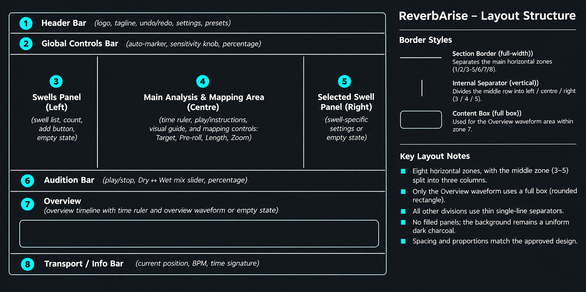
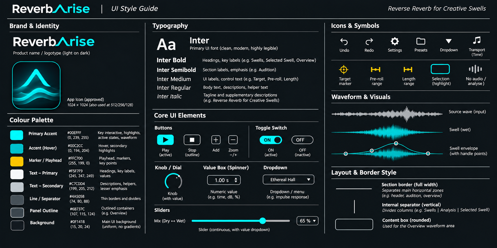

# ReverbArise — UI Layout & Visual Style Guide

**Version:** 1.26 · **Production standards revision:** 26 · **Purpose:** Production UI authority and design reference. Revision 26 adopts the approved dialog, native-picker and auxiliary-window lifecycle, retaining revision 25 text and aqua-help policies. Keyboard and accessibility focus use aqua outer brackets on shared controls, with decoration suppressed after pointer input.

See the [control inventory and family roadmap](ui-control-inventory.md),
[shared contracts](../development/ui-control-contracts.md) and
[approval/evidence](../validation/2026-11-06-issue-107-control-audit.md).
Legacy debt remains explicit; family migrations retain scoped native approval.

## Dialogs, native pickers and auxiliary windows — issue #107

Reuse `OwnedAlertWindow` for measured alert/custom content and native close
chrome, `WorkspaceWindow` for Settings/Diagnostics, and shared controls within
them. Rename starts in Name, group Delete on Cancel and recovery on Continue.
Escape/title-bar close dismiss without a primary action. Field cancellation,
accepted settings and guarded Storage cancellation/handoff remain authoritative.

`SurfaceInvocation` owns pending UI lifetime and one-shot completion.
`SurfaceFocusReturn` defers return to an eligible visible opener/fallback with
input-appropriate decoration. Native Windows pickers retain modes, filters and
overwrite behavior. Auxiliary content keeps one scale transform, comfortable
text and focus-aware scrolling. Do not reopen a hidden owner. See
[P8 evidence](../validation/2026-11-11-issue-107-dialogs-windows.md).

## Text and contextual help — issue #107

Use semantic text roles for captions, explanations, empty states and status.
`WrappedLabel` measures and paints the same layout, including unbroken paths.
Allocate its preferred height and reflow or scroll following content.
`EllipsisLabel` retains the full ordinary text in its accessible description
and contextual help while a single visible line shortens with an ellipsis.
Bindings can provide a more specific description.

The shared hover-help footer uses `contextHelpInk`, the existing softer aqua
`#00C2CC`, at the helper text size. Permanent helper prose keeps its ordinary
text role. Local validation remains red and workspace notices retain their
severity. The fixed transport readout and bounded notice typography are
established specialized presentations.

## Connected tabs — issue #107

The workflow header, Learn sections, Swell Inspector sections and Settings use
the same connected strip. The accepted tab has an aqua fill. Quiet hover and
stronger held feedback change the tab's border and background. Adjacent tabs
share one edge, with rounded ends at the outside of the strip. Keyboard and
accessibility focus show aqua corner brackets with a gap outside the tab body.
Clicking keeps actual focus and hides the brackets.

Settings keeps About last, immediately after Storage. The existing Appearance
page remains available before Storage in the responsive layout. See the
[C7 contract](../development/ui-control-contracts.md#c7--navigation-lists-tabs-and-scroll-containers)
for selection and focus behavior.


## Selector family — issue #107 (native approved)

The owner approved the quiet dropdown/menu design on 7 November 2026, including
transient pointer hover, persistent keyboard inspection and an independent
selected checkmark. The owner approved the revised native family on 7 November,
including small local help/red error feedback. `unify-selector-states` adopts
only its listed consumers; remaining families and #8 controls remain explicit debt.

The owner also approved smaller help immediately beneath the input and **red
validation text plus a red body border**, with aqua focus brackets independent,
on 7 November. The revised native fixture starts in a clearable validation-error
scene and uses the scoped `FieldPresentation` policy (12-height Inter Regular,
17-height line box, 4-unit body-to-feedback gap). Routine help returns when the
error clears; disabled explanations remain readable. This shared field anatomy
is recorded for later text/numeric jobs, without migrating their controls here.

The [C2 contract](../development/ui-control-contracts.md#c2-approved-implementation--2026-11-07)
records the shared API and scoped approved metrics. Review at normal and larger
sizes and 100%/125% user scale uses `preverb_selector_popup_test --review-selectors`.
Physical Windows DPI and FL Studio results remain distinct. #108's Level work,
#8's storage/recovery work and the separate action-menu child are not adopted by
this fixture.

C2 value text retains the native-approved control-value height of at least 13,
while larger responsive roles can grow it. This scoped selector role keeps the
12-height local helper smaller in compact layouts; it does not change text/numeric
input typography. `SelectorPresentation::valueFont` is the authority for closed
selectors and their popup values. Visible selector/import bodies remain aligned;
outside focus is reserved in the component frame and existing row gaps are retained.

## Action menus — issue #107

The [C2 action-menu contract](../development/ui-control-contracts.md#c2-action-menus--issue-107)
defines explicit neutral and destructive rows. The menu reuses the selector
popup geometry and Inter text. Neutral actions use quiet dark fills.
Destructive actions use `danger` ink and edge emphasis with a 14% hover blend
and 24% held blend from `background` toward `danger`. The owner approved those
popup roles in the native fixture on 7 November 2026. Action menus clear
pointer emphasis on departure and retain active keyboard inspection. Selection
marks belong to choice menus. Revision 16 adopts this policy for Swells
Rename/Delete and per-knob Reset menus. Right-click a knob for its captured
Reset action. Menu focus restoration keeps the knob's existing bracket geometry.

## Source-range field feedback — issue #107

In Settings → Swell, each bar input has its caption above the body. A shared
message below the pair wraps within the span of the two input borders. Help uses
12-height Inter Regular, 17-unit lines and the existing 4-unit gap. The controls
below move with the measured message height. A rejected range uses red text and
marks the affected input border in red. Aqua focus brackets sit outside that
border. Guidance remains readable when the action is unavailable.

## Level — issue #108

The owner approved issue #108's standard Level knob on 2026-11-07. All new
edits use -12 to +12 dB, with 0 dB at 12 o'clock and as the default and reset.
Wheel and key steps are 1 dB or 0.1 dB with Shift. Older saved gains below
-12 dB appear in the ordinary input and stay applied until a Level edit.
Pressing the dial brings an older gain to -12 dB. The UI development standards
describe the shared binding and accessibility behavior.

## Responsive composition — issue #58

This section takes precedence over the older fixed-size Learn/header values
below for the main editor. The owner approved Option A revision 4, its interim
native composition and the combined #51/#68/#93 layout. See the
[integration evidence](../validation/2026-11-06-issue-58-integration.md) for review
corrections and separately outstanding host/DPI and Appearance interaction checks.

`ResponsivePresentation.h` owns the named composition tokens. Baseline/default
content is 900x600 at 100%; useful expansion includes 1000x700, 1100x850,
1400x900, 1400x1000 and 1600x1000. These are logical workspace sizes, distinct
from user magnification and host/Windows scaling.

| Role | 900x600 | 1100x850 | 1400x1000 |
| --- | --- | --- | --- |
| Heading / navigation | 16 / 14 | 18 / 16 | 21 / 18 |
| Body / caption and value | 12 / 11 | 13 / 12 | 14 / 13 |
| Notice | 12 | 13 | 14 |

Roles interpolate using both dimensions through `ResponsiveTypography`; a wide,
short window cannot overgrow text. Normal notices use the whole reserved row;
exceptional wrapping has an 11-height floor and retains full accessible details.
The transport readout retains its independently approved fixed 15-height font.

| Token | Value / scope |
| --- | --- |
| Outer horizontal margin | 12 |
| Content padding / group gap | 8 / 12 |
| Perpendicular-divider clearance | 8 at both ends; no touching T/cross junctions |
| Control / exact entry / compact dial | 32 / 26 / 36 |
| Exact-entry horizontal inset | 6 |
| Header / tab / audition bands | 64 / 32 / 48 |
| Perform list / inspector widths | 160 / 276 |

Learn uses Capture & Generate / Sound tabs, with Generate/readiness/manual help
below the content. Sound's current Default IR/import controls stay available
with automatic detection off. Its scope note follows the controls. Shared Sound
uses the same IR field family as Perform; a Learn Level default remains a separate
extension. The hosting Sound section owns context explanations outside that field.
Perform uses Timing / Envelope / Sound; Enabled/Solo/Freeze and Reset actions
stay outside inspector scrolling. Export retains its dominant preview, accepted
Character/Dry/Wet family and protected file/return actions. No future DSP slots ship.

Use the shared PresentationSurface transform once for 100%/125% user scale.
Owned Settings/Diagnostics keep comfortable typography, magnify consistently
and use bounded viewports with focus reveal when the work area is constrained.
Native choosers and native chrome keep their platform policy. No sub-100%
choice is supported without separate native readability/interaction approval.

## Validated production standards — Learn and shared header

This section takes precedence over historical numerical suggestions below. Values
are extracted from approved Learn #11/PR #39 and header #35/PR #40 code at main
`2848fcd`, with [approval and validation scope](../validation/2026-11-04-issue-37-ui-standards.md).
They preserve existing appearance; they do not approve unrelated legacy controls.
All sizes are JUCE logical pixels/font heights, not typographic points or physical
Windows pixels. Use the embedded static Inter faces and shared role APIs; installed
font lookup, synthetic weights and implicit default fonts are not alternatives.

### Typography and semantic ink

| Role / consumer | Height, face and line box | Code authority / ink |
| --- | --- | --- |
| Learn section heading / timeline title | 21 SemiBold, 30 box | `WorkspaceTheme` / `UiGeometry`; primary `#F8FAFC` |
| Learn control label | 14 Medium, 24 box; switch labels vertically centred | Same; primary |
| Learn helper and metadata | 14 Regular, 20 per line; helper supports two lines | `learnTypography`; `#C4CCD4` |
| Learn ruler | 14 Medium, 20 box | Learn painting; primary |
| Learn empty heading | 24 SemiBold, 32 box | Theme / `learnGeometry`; primary |
| Learn empty body | 14 Regular, 40 box for two lines | Theme / `learnGeometry`; Learn helper ink |
| Header tagline | 21 Italic, 46 primary row | Theme / `WorkflowHeader`; primary |
| Mode navigation | 18 SemiBold, 36 control | Theme / `SegmentedSelector`; selected/inactive semantic ink |
| Header description and notice body | 14 Regular, 32 information row | Theme / `HeaderInformation`, header `NoticeBar`; `#C7CDD4` |
| Numeric control value / dropdown | 13 Regular, 28 value / 34 control | Theme / control geometry; primary |
| Perform transport readout | 15 Regular, existing information band | `Controls/TransportReadout`; primary |

There is no universal line-height multiplier. Preserve the actual text box and
face as well as font height. General legacy `smallSize=12`, `captionSize=11` and
`modeDescriptionSize=16` are not permission to shrink a new production role;
the actual approved header description uses the 14 body role.

| Semantic role | Value | Authority and use |
| --- | --- | --- |
| background / aqua / hover | `#0F1418` / `#00EFFF` / `#00C2CC` | `WorkspaceTheme`; uniform surface / accent / hover |
| timing | `#FFC700` | Theme; restrained timing/targets |
| primary / general secondary | `#F8FAFC` / `#EDF1F5` | Theme; retain general secondary separately |
| separator / outline | `#4A5058` / `#6B737C` | Theme; thin dividers / interactive outlines |
| danger / warning | `#FF6B5E` / `#E6BB72` | Theme; error / warning semantics |
| Learn helper / header body | `#C4CCD4` / `#C7CDD4` | Scoped roles above; do not merge near-matching colours |

Existing captured-silence, unavailable-source, wet-data, stale and preview-cursor
colours remain named data roles in `WorkspaceTheme`; data classification is not
a general accent variant. Copy, severity and real coverage supplement colour.

### Comfortable geometry and responsive layout

| Role | Approved Learn/header measurement | Authority |
| --- | --- | --- |
| Comfortable rhythm | tight 4, label-help 6, related 12, group 16, section 24 | `UiGeometry::spacing` |
| Control / label / heading heights | 34 / 24 / 30 | `controlGeometry` |
| Numeric value / step strip | 74 x 28 / 18 wide | `controlGeometry` |
| Switch track / component | 44 x 24 / 56 x 36 | `Switch` and control geometry |
| Inline checkbox indicator | 18 x 18 | `BooleanToggle` and the existing focus clearance |
| Focus | 2 stroke, 3 outset, 6 padding | Control geometry; contain the full stroke |
| Rule / ordinary radius | 1 / 4 | Theme; switches and joined segments retain their own geometry |
| Learn settings / column gap | 304 / 28 | `workspaceGeometry` |
| Outer inset | 16 below editor width 1200, otherwise 20 | `workspaceGeometry::outerInset` |
| Header | 82 high; 46 primary and 32 information row | `WorkflowHeader`, `WorkspaceLayout` |
| Header navigation | 330 below header width 1200, otherwise 360; 36 high | `WorkflowHeader`; inner-width breakpoint differs from editor inset |
| Mode icon / label gap | canonical 16 canvas / 8 | `ModeIcon`, `SegmentedSelector` |
| Header description accent | 2 x 16, 8 text gap, 8 trailing inset | `HeaderInformation` |
| Learn metadata / ruler gap | 6 / 10 | `learnGeometry` |
| Empty icon / heading / body boxes | 38 / 32 / 40; gaps 12 / 6 | `learnGeometry` |

Supported logical sizes are 1100x850 minimum/default, 1400x900, 1400x1000 and
1600x1000. Learn remains a narrow settings column and one dominant dry canvas;
Perform uses the approved scoped profile below. The notice
row remains reserved without shifting controls. Preserve the wordmark SVG,
canonical monochrome mode SVGs, square inner segment joins, outer rounded ends
and focus/shared-edge painting. Do not add raised cards, shadows or new controls.

### Shared controls and density governance

Use `Controls/Switch`, `SliderControl` with `NumericInputControl`,
`SegmentedSelector`, `IconActionButton`, `HeaderInformation` and `NoticeBar`.
Use the invocation-aware IR selector's shared no-wheel policy. Screen code owns
placement and domain copy; bindings retain ranges, units, validation, accepted
model state and stale invocation rejection. See [UI development standards](../development/ui-development-standards.md)
for ownership, remaining migration, tests and review fixtures. Shared styling
alone does not make an independent widget a shared library control.

Comfortable means the approved Learn usage of the existing spacing/geometry
roles. `compactInset` is an existing width-breakpoint name, **not** a compact
density profile. The approved Perform compact profile below has no runtime toggle.
Further profiles may alter named spacing, row/group gaps and column allocation
only after assessment with representative dense content.
Typography, semantic ink, legibility, focus and interaction language are
invariants. Do not solve density by shrinking text. Review overflow, waveform
room, hit targets and keyboard access at supported sizes before adopting values.

New tokens, visual variants and one-off exceptions need explicit owner review
with rationale, named scope/consumers, native evidence where applicable and
regression coverage. Materially changed/new families need both look and feel
approval before wider rollout. An unchanged extraction retains prior acceptance.
Record approved changes in code and this guide together and increment the
production standards revision; this revision does not change plugin/state versions.

| Revision | Baseline / decision | Scope |
| --- | --- | --- |
| 1 | #11 and #35 approved native implementation, extracted in #37 | Learn comfortable and shared header; compact values await Perform review |
| 2 | #4 standalone list look/feel approved 2026-11-04 | Swells list identity/scroll interaction policy; existing Perform row appearance retained, no new visual values or compact profile |
| 3 | #46 revision-4 native compact composition and Snap family approved 2026-11-04 | Perform-only profile below; shared Zoom/Fit controls from merged #49, no Learn/header density changes |
| 4 | #46 owner approved Level 1 dB / Shift 0.1 dB and four-corner knob focus | KnobValue-only focus: existing aqua, 2-pixel contained stroke, open sides, legs 20% of inside box (8 pixels for 42-pixel dial); actual native look/feel approved 2026-11-04. Other families and layout tokens unchanged |
| 5 | #46 owner approved revised presentation on 2026-11-04 | Perform 52-pixel single-row audition strip, grouped inspector/full Source labels, compact values with exact editing, shared ruler and aligned headings; normal-font bottom context help across modes. Existing typography/control families reused; no popup tooltips |
| 6 | #68 native readout look/feel approved 2026-11-05 | Perform-only stable Bar, Beat, BPM and meter slots; existing footer 15-pixel Inter Regular/primary ink and tight/related spacing retained. No highlight decoration or host behavior change |
| 7 | #58 Option A revision 4 and interim/combined native composition reviewed 2026-11-05/06 | Responsive main-editor roles, named 900x600 composition, persistent Reset, Learn/Perform sections and delivered Export family. Appearance/auxiliary interaction and host/DPI acceptance remain separately recorded; no DSP/default Level extension |
| 8 | #80 revised native IR family approved 2026-11-06 | Shared IR label/selector/import and closely grouped feedback using existing tokens; red actionable failures remain readable with disabled inputs, text wraps without shrinking, and hosts own scope explanations. Family approval permits integration; integrated composition and host/DPI acceptance remain separate |
| 9 | #80 integrated-review correction requested 2026-11-06 | Folder/import and Settings glyph buttons reuse ActionButton's surface: stable off-white content and aqua hover/pressed outline, existing contained focus/disabled treatment. No new token; wider legacy button-state audit remains #107. Corrected native interaction approved 2026-11-06; evidence is separately recorded |

| 10 | #80 owner identified idle IR-to-Level gap on 2026-11-06; revised native spacing approved | Empty IR feedback collapses; present feedback uses one or two helper lines and adjacent fields reflow using existing spacing. Reset remains fixed. No new token |
| 11 | #107 audit and shared contracts explicitly approved 2026-11-06 | Full consumer ownership/state inventory, C1–C8 contracts and separate P1–P8 delivery packets, reconciled against merged #80. Documentation/governance only; all numerical roles and native approvals unchanged; #108 and #8 remain independent |
| 12 | #107 native button family revision 4 approved 2026-11-06 | Four aqua corner brackets, 2-pixel stroke with 3-pixel outside gap inside component bounds; body border/background owns hover/press. Destructive mouse feedback stays red; neutral icons stay off-white. Explicit neutral/primary/destructive/latch roles share one painter. No new token, knob or FileDragTile redesign; integrated acceptance remains separate |
| 13 | #107 owner approved input-dependent focus visibility 2026-11-06 | Shared commands show brackets for keyboard/accessibility focus and hide them after pointer clicks while retaining actual focus/activation. Hover/held ink and geometry stay unchanged. Other families adopt the policy during their own jobs; caret/editing/selection feedback remains separate. See the shared focus visibility contract |
| 14 | #107 revised native selector family approved 2026-11-07 | Quiet transient pointer highlight, persistent keyboard inspection, independent accepted checkmark and explicit commit; aqua outside focus, steady glyphs. Scoped popup metrics and minimum 13 value type; local help uses 12-height Inter, 17-height lines and 4-unit gap, with red error text/body border. Adopted consumers are listed in the C2 contract; action menus, #108 and #8 stay separate. |
| 15 | #108 standard Level knob approved 2026-11-07 | Fixed -12 to +12 dB edits and 0 dB at 12 o'clock. The ordinary input preserves older gains until Level is operated |
| 16 | #107 native action-menu family approved 2026-11-07 | Swells Rename/Delete opens from the row or its three dots. Per-knob Reset uses the same presenter and its captured action. Explicit neutral and destructive roles use transient hover, held feedback and separate keyboard inspection. |
| 17 | #107 native field feedback approved 2026-11-07 | Settings Swell puts captions above the source-range inputs and wraps one local help or validation message below them. The existing field metrics, error ink and focus geometry apply. |
| 18 | #107 native numeric and text fields approved 2026-11-09 | Shared editable, embedded and read-only field surfaces. Existing field metrics apply to wrapped inspector and Rename feedback. Compact embedded entries keep context help and configured stepper behavior. |
| 19 | #107 native knobs and sliders review | Aqua value arc or track, off-white position marker, and shared outer focus brackets. Quiet pointer feedback follows the dial arc or the slider track body. Ctrl+wheel uses the control's fine step. Level has a drag-only 0 dB detent with a ±0.3 dB band and a quiet tick at 12 o'clock. |
| 20 | #107 native switches and checkboxes approved 2026-11-10 | Labeled switches in Learn and Settings. Enabled, Solo and Freeze use inline checkboxes. Both forms share quiet hover, held feedback, readable disabled state and outer aqua keyboard/accessibility brackets. |
| 21 | #107 native connected tabs approved 2026-11-10 | Editor and Settings use connected tabs with quiet pointer states, independent keyboard/accessibility focus and About last in Settings. |
| 22 | #107 native Export file interaction approved 2026-11-10 | The ready WAV tile starts a native copy gesture. Windows shows the approved WAV badge over accepting targets and the stop cursor over rejecting targets. The pointer drag uses a solid outline and restores the dotted affordance at the end. The cursor badge's 8.5 logical-unit label belongs to this artwork. |
| 23 | #107 native Swells list and scrolling approved 2026-11-10 | The virtualized list uses square Enabled checkboxes and keyboard-accessible row actions. Group Delete requires confirmation with Cancel focused. Rename is dimmed during multiselect. Unavailable popup rows stay quiet under the pointer and short popup highlights reach the inner edge. |
| 24 | #107 P8 native waveform gestures approved 2026-11-10 | Main waveforms share pointer-anchored wheel zoom, middle-drag pan and aqua keyboard/accessibility brackets. Left positions the local marker or edits a Perform handle. The compact Perform Overview uses left-drag alone to pan the detail range. |
| 25 | #107 P3 native text and aqua footer approved 2026-11-10 | Shared measured wrapping and complete label descriptions across the plugin. Context help uses the existing softer aqua #00C2CC. Existing local errors, notice severity and transport geometry retain their established roles. |
| 26 | #107 P8 native dialogs, choosers and auxiliary windows approved by the owner; adoption 2026-11-11 | Shared dismissal and input-appropriate focus return, native dialog close chrome, retained Windows pickers and operation guards, existing single-transform scaling and scroll access. |

Loop Arm retains the owner-approved #133 destructive latch appearance (2026-11-09): red text and outline when off, red fill with dark text when armed, and independent aqua keyboard focus. This reuses the existing command variant.

### Stable Perform transport information

`Controls/TransportReadout` owns the four read-only slots, fixed separators and
centred status group. Right-align numbers inside font-measured value reserves;
never centre or resize the combined live string. Reserve signed six-digit bars,
three-digit beats plus three decimals, four-digit BPM plus two decimals,
three-digit meter parts and full unavailable text. This is a display budget,
not a host-domain limit. Larger values ellipsize within their own slot and retain
full accessible/context-help text. Reuse existing primary ink, 15-pixel Inter
Regular and tight/related spacing; no automatic font compression. The owner
approved this scoped family in its live native preview before editor integration.
See [binding and sizing policy](../development/transport-readout.md).

### Chronological Swells list interaction

`Controls/SwellList` owns the specialized virtualized list. Rows follow canonical
absolute arrival samples with an ordinal persistent-ID tie-breaker. Names and wet
placement never determine order. Selection and delayed commands follow IDs;
snapshot refresh submits no edits. Keep the visible row's pixel offset during
background insertion/reordering, reveal explicit selection or a moved visible
primary minimally, and do not repeatedly reveal an offscreen primary. Clear
ephemeral ownership on session replacement. Preserve the current row rendering
through extraction; this does not validate legacy Perform measurements as new
defaults. See [shared control policies](../development/ui-development-standards.md)
and [scoped approval/evidence](../validation/2026-11-04-issue-4-swell-list.md).

## Approved scoped Perform compact profile — issue #46

The owner approved the actual revision-4 native composition on 4 November 2026.
`PerformLayout.h::performGeometry` owns these scoped metrics; comfortable Learn
and shared-header defaults remain unchanged. The fixture and production editor
consume the named profile following merged Export PR #50.

| Allocation | Below / at-or-above editor width 1200 |
| --- | --- |
| List / inspector / column gap | 180 / 304 / 16; wide 210 / 320 / 16 |
| Column content inset | 12 from horizontal rules |
| Audition / Overview / info bands | 52 / 120 / 36; bottom help consumes existing padding and at most four pixels of position/body space |
| Toolbar / readout | 48 / 26 |
| Toolbar inset / control / external gap | 6 / 36 / 8 |
| Snap / grid widths | 96 / 136; remaining width belongs to approved shared Zoom/Fit row |
| Audition and Overview vertical inset | 8 |

Horizontal rules remain continuous after child painting; vertical rules stop
short of band boundaries. Obsolete Perform marker tooling is omitted. Typography,
list row heights, semantics and inspector field capabilities retain their separate
authorities. The latching action family received its separate native approval;
automated production binding and grid tests establish its integrated behavior.
See [#46 evidence](../validation/2026-11-04-issue-46-perform-composition.md).

## Historical design intent and provisional suggestions

The remaining Parts I–III retain the original design reference. Their generic
eight-region layout, palette/type tables and numerical starting suggestions do
not override the production section above or authorise unimplemented features.

This document combines two design references: **(1) Layout Structure / Border Specification** and **(2) UI Visual Style Guide**. The product name is **ReverbArise** (previously Preverb). The objective is a professional, minimal, high-contrast audio-plugin interface: dark charcoal, aqua/teal highlights, carefully restrained yellow timing markers, and a large waveform editor.

> **Reference images:** The two supplied visual guides are included in the companion asset package. The written descriptions below are the implementation reference; where generative imagery includes contradictory or speculative controls, preserve the previously agreed product scope instead.

---

## Part I — Layout structure and borders



### 1. Overall structure

The plugin has **eight numbered functional regions**, arranged in six principal horizontal bands: a full-width header (1); global controls (2); a three-column main workspace (3–5); audition (6); overview (7); and transport information (8).

```text
┌──────────────────────────────────────────────────────────────────────────┐
│ 1  HEADER: waveform-A wordmark, tagline, undo/redo, settings, presets   │
├──────────────────────────────────────────────────────────────────────────┤
│ 2  GLOBAL CONTROLS: Auto-marker [On/Off]   Sensitivity [knob + value]    │
├───────────────┬──────────────────────────────────┬───────────────────────┤
│ 3  SWELLS     │ 4  MAIN EDITOR                    │ 5  SELECTED SWELL     │
│               │                                  │                       │
│ Count, add,   │ Ruler; source waveform;          │ Name / enabled       │
│ select, enable│ wet waveform / envelope;         │ Individual IR        │
│ name, IR      │ transient/arrival marker;        │ Pre-roll, end offset │
│               │ handles for start, peak, end;    │ fade in/out, gain,   │
│               │ target/readout and zoom          │ curve, numeric entry │
├───────────────┴──────────────────────────────────┴───────────────────────┤
│ 6  AUDITION: Play / Stop   Dry ←───── mix ─────→ Wet   editable %         │
├──────────────────────────────────────────────────────────────────────────┤
│ 7  OVERVIEW: ruler +  ┌──────────────────────────────────────────────┐  │
│                        │ full-song capture / waveform / swell map   │  │
│                        └──────────────────────────────────────────────┘  │
├──────────────────────────────────────────────────────────────────────────┤
│ 8  TRANSPORT / INFO: song position  |  BPM  |  time signature            │
└──────────────────────────────────────────────────────────────────────────┘
```

The ASCII lines above explain regions; **they do not mean every region has a visible rectangular border**.

### 2. Actual border rules

| Border treatment | Where used | Where *not* used |
|---|---|---|
| **Thin horizontal rule** | Across major section transitions: after header, between working area and audition, around overview/transport divisions where present in the approved design | Do not box every control or label |
| **Thin vertical rule** | Between the Swells list, main editor, and Selected Swell inspector | No full rectangular panels enclosing each column |
| **Subtle internal separator** | A few small group boundaries, such as waveform lanes or headings, where necessary for readability | Avoid repeated heavy/double rules |
| **Full rounded outline** | **Overview waveform viewport** inside the overview section | Do not add rounded cards around global controls, left list, editor, or inspector |
| **Control outline** | Interactive numeric fields, IR dropdown, buttons, toggles and selected-list highlight | Not a substitute for container/layout lines |

The **background is one continuous dark-charcoal field**. Large filled cards, separate raised panels, drop shadows, heavy outlines, gradients and skeuomorphic bevels are out of scope for this visual language.

### 3. Region notes

**1 — Header:** Waveform-shaped **A** within the *ReverbArise* wordmark; subtitle “Reverse Reverb for Creative Swells”; optional existing undo/redo, settings and preset controls. Do not invent new audio processing controls here.

**2 — Global controls:** Auto-marker on/off, sensitivity knob and typeable percentage. These govern automatic transient suggestions across the captured song.

**3 — Swells (left):** Counter, manual add, scrollable list of swells. Each item identifies the swell, its enabled state and its **own IR assignment**; selected item has a thin aqua highlight. In the empty state display “No swells yet” and a short instruction.

**4 — Main editor (center):** Main visual priority. Source dry waveform on top, selected wet swell / envelope below; a time ruler, transient/target markers, directly draggable start/peak/end handles, selected timing and zoom. **End Offset** permits the wet swell to end before or after the target, including an overlap with the uninterrupted dry input. In the initial state display a restrained “Press play to begin mapping your song” prompt in place of waveforms.

**5 — Selected Swell (right):** Context inspector, blank instructional state if nothing selected. For a selection: swell title, per-swell IR selector; Pre-roll/Start; End Offset (overlap); Fade In; Fade Out; Level; Curve. Knobs and typeable exact values mirror changes made by dragging main-editor handles. Do not repeat the envelope graph as a second editor here.

**6 — Audition:** Play/Stop and the accepted latching listening-mode button, showing Dry + wet when Off and Wet only when On. Equal 8-pixel action gaps and inline readiness status fit the approved 52-pixel strip. Play loops the finite prepared window until Stop or an existing safety guard. Audition remains independent of Export; existing protection and legacy monitoring preferences remain disclosed.

**7 — Overview:** Header must read **“Overview”** (not “Song Overview”). Contains the **only major rounded outline** around the complete-song timeline. Shows actually captured regions versus unmapped gaps, current viewport and swell locations; empty state “No audio mapped yet”. Do not invent waveform data for uncaptured regions.

**8 — Transport/info:** Position, host tempo and time signature as reported by the DAW. This region is informational, not a duplicate set of host transport controls.

### 4. Spacing and responsive behavior

- Keep generous margins around the outer canvas and clear visual gaps between controls.
- Use a stable three-column work area; allocate most width to the center waveform editor, a narrower swell list at left and a moderate inspector at right.
- Preserve vertical room for waveform manipulation; do not shrink the source/wet lanes to accommodate more buttons.
- Use consistent small spacing between related labels and inputs, with noticeably larger space between major sections.
- Suggested **starting values**, not extracted measurements: outer padding `16–24px`, section rhythm `8–16px`, control spacing `4–12px`.
- Validate at actual JUCE plugin window sizes and DPI scales; the mockup is a visual reference, not pixel-exact production geometry.

---

## Part II — Visual style guide



### 5. Brand and approved mark

- **Name:** ReverbArise (capital **R** and **A**).
- **Wordmark:** “Reverb” light/white + “Arise” aqua. The **A in Arise is the stylized rising waveform/envelope glyph**, integrated into the word rather than duplicated as an unrelated mark to the left.
- **Tagline in approved mockup:** *Reverse Reverb for Creative Swells*.
- Use the approved UI wordmark as the primary reference. The standalone square “app icon” shown in the generative style-guide sheet is a **conceptual illustration**, not independently approved vector artwork. **Do not hand-draw a different logo shape based only on that square.** A vector production logo/icon should be extracted/refined from the selected waveform-A concept in a separate asset task.

### 6. Color palette

These values are **proposed color tokens transcribed from the generated style-guide illustration**. They are suitable implementation starting points but should be sampled/visually checked against the approved screenshot before final sign-off.

| Token | Proposed hex | Intended usage |
|---|---|---|
| `color.background` | `#0F1418` | Uniform deep charcoal base (no gradient) |
| `color.accent.primary` | `#00EFFF` | Selected swell, waveform envelope, active controls, wave-A / Arise wordmark |
| `color.accent.hover` | `#00C2CC` | Muted aqua, hover/secondary emphasis |
| `color.marker` | `#FFC700` | Target/arrival marker, playhead and timing/range accents |
| `color.text.primary` | `#F5F7F9` | Headers, labels and important values |
| `color.text.secondary` | `#C7CDD4` | Explanations, less prominent values and help text |
| `color.separator` | `#4A5058` | Delicate borders/rules, subdued structural separation |
| `color.outline` | `#6B737C` | Interactive field and occasional content viewport outlines |

Use neutral grey waveforms for **source input**, aqua for **wet swell**, and yellow for the **target position**. Aqua should not flood large surfaces; its impact comes from selective use. Use a subtle (not glowing) highlight on the selected swell.

### 7. Typography

**Reference font:** Inter, or a legally bundled/system-available metrically similar modern sans-serif. Do **not** distribute any third-party font binary without checking its license and packaging requirements.

**Approved implementation (#16):** bundle Inter 4.1 static Regular (400),
SemiBold (600), Bold (700) and Italic (400) faces. Resolve each from embedded
font bytes through one shared policy for JUCE components and custom Graphics
painting. Do not select weights through installed-family lookup or mix in Segoe
UI for bold/italic. The owner approved the static Inter comparison on 2026-11-03,
including its fuller small-text appearance. Keep the existing sizes, colors,
alignment and spacing. Zoom-label wrapping is accepted for now; its buttons will
be addressed with the Perform workspace redesign. Retain the bundled OFL notice.
The SVG wordmark remains unchanged. Segoe comparisons in dated validation reports
are historical evidence, not the current font-selection policy.

| Style | Intended content |
|---|---|
| Inter **Bold** | Plugin brand, main headings, Swells / Selected Swell / Overview |
| Inter **SemiBold** | Section labels and emphasized selected swell name |
| Inter **Regular** | Control captions, target/pre-roll/length labels, numeric display, helper text, descriptions and secondary metadata |
| Inter **Medium** | Learn control labels (500), subsequently approved in #11; see production section above |
| Inter *Italic* | Tagline and occasional supplemental instructions |

Prefer clear type size/weight contrast over decorative typography and align captions, knobs and their numeric fields on a consistent grid. Dial value fields use the shared 74-unit width where it fits. Inline feedback aligns beneath the field and wraps within its value column. Target's entry format lives in the hover-help footer and accessible field description. Keep the empty-state headline prominent but not oversized.

### 8. Controls and interaction styling

| Component | Appearance | Required interaction |
|---|---|---|
| Active button | Solid aqua fill, dark icon | Primary audition Play |
| Secondary button | Charcoal background, thin grey/white outline | Stop, add/delete, zoom controls |
| Toggle | Aqua track when on; outlined inactive state when off | Auto-marker, enabled state |
| Knob | Thin aqua value arc with muted remainder | Coarse mouse drag + fine adjust; numeric readout |
| Numeric field | Small outlined field, legible units | **Typeable exact values**, validated to real parameter domain |
| Dropdown | Outlined rectangle and small chevron | Per-swell IR selection; available options only |
| Slider | Thin aqua filled portion, subdued remainder | Audition dry/wet mix; precise value entry |
| Selection | Thin aqua outline / restrained fill | Current swell in left list, selected viewport |
| Handle | Small outlined circular point on bright aqua line | Edit swell beginning/curve/peak/end directly in the editor |

Avoid duplicate ways of displaying the *same graph*: envelope handles belong in the main editor; knobs and precise numeric entry belong in Selected Swell. The same data is always synchronized in both directions.

### 9. Iconography

Simple, consistent stroke icons. Approved motifs shown in the source sheet include:

- Undo and redo curved arrows
- Settings gear; presets folder; dropdown chevron
- Play triangle, stop square; add/zoom plus and minus
- Thin yellow target crosshair and timing/range glyphs
- Grey source-audio bars / aqua wet waveform
- Outlined circular envelope control points

Use a consistent stroke weight and align icon geometry optically. Icons are supportive—not decorative or large status illustrations in every region.

### 10. Waveform design

- Dry/source waveform: muted off-white/grey, clear attack and decay.
- Wet/swell waveform: saturated aqua, drawn below the source.
- Envelope curve: a thin bright aqua line overlaid on wet waveform, with draggable handles at important points.
- Target: distinct narrow yellow dashed vertical line, consistent across both lanes.
- Positive **End Offset**: wet envelope extends beyond the yellow target marker over the unchanged dry event; negative offset leaves a gap before the target.
- Overview waveform: neutral grey, with aqua swell indicators and a single thin aqua viewport highlight.
- Mapping coverage is a genuine data state: uncaptured zones must not be displayed as if recorded.

### 11. States

**Initial/empty:** Swells (0), no waveform content, concise “Press play to begin mapping your song”, inspector “No swell selected”, Overview “No audio mapped yet”. Auto-marker ON and sensitivity visible, default IR configured internally. Do not force a file import or a Generate command.

**Capturing/processing:** Auto-map incoming dry audio at DAW positions, detect candidate attacks and schedule per-swell convolution automatically. Subtle non-blocking state feedback is preferable to heavyweight progress panels.

**Ready/selected:** Left list shows per-swell IR; source and wet waveforms + draggable envelope occupy the center; inspector shows relevant selected-swell knobs and numeric fields; overview remains visible; audition can mix captured dry with wet.

**Updating:** Edits to IR/source rendering inputs cause background rerender only where necessary. Edits to fade, level and playback range should apply without unnecessary full convolution. Preserve the last good completed render until replacement is ready.

### 12. Scope discipline

The style mockup is an **end-goal appearance**, not permission to add new DSP features. In particular, do not add EQ high/low cut, general stereo-width or decay controls, redundant wet-only buttons, repeated envelope graphs, CPU meters, speculative tabs, fake capture data, or a prominent Generate/Regenerate workflow solely to match an image. Diagnostics may remain in a developer-facing area separate from the main UX.

---

## Handoff checklist

- [ ] Preserve all eight layout regions and the three-column central workspace.
- [ ] Thin lines rather than filled cards; Overview contains the only large rounded full-box viewport.
- [ ] Approved charcoal/aqua/yellow visual roles; **waveform A inside Arise**.
- [ ] Source waveform + wet waveform with selected, manipulable envelope.
- [ ] Per-swell IR selection; knobs plus typeable exact numbers.
- [ ] Positive/negative end offset around unchanged dry event.
- [ ] Auto-marker on/off and sensitivity.
- [ ] One audition listening-mode toggle, showing its selected Dry + wet / Wet only state, and inline truthful status.
- [ ] Overview visible in both empty and loaded states, titled **Overview**.
- [ ] No speculative or duplicated controls; preserve source/processing correctness.

### Source artwork

1. `ReverbArise_Layout_Structure_Reference.png` — thin borders vs. a full Overview content box.
2. `ReverbArise_Visual_Style_Reference.png` — colors, typography, wordmark, icons, waveform styling, and interactive elements.

Both are included in the accompanying ZIP with this Markdown file so the relative image links render when unpacked together.
