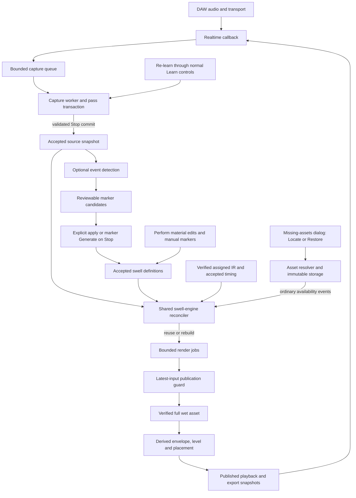
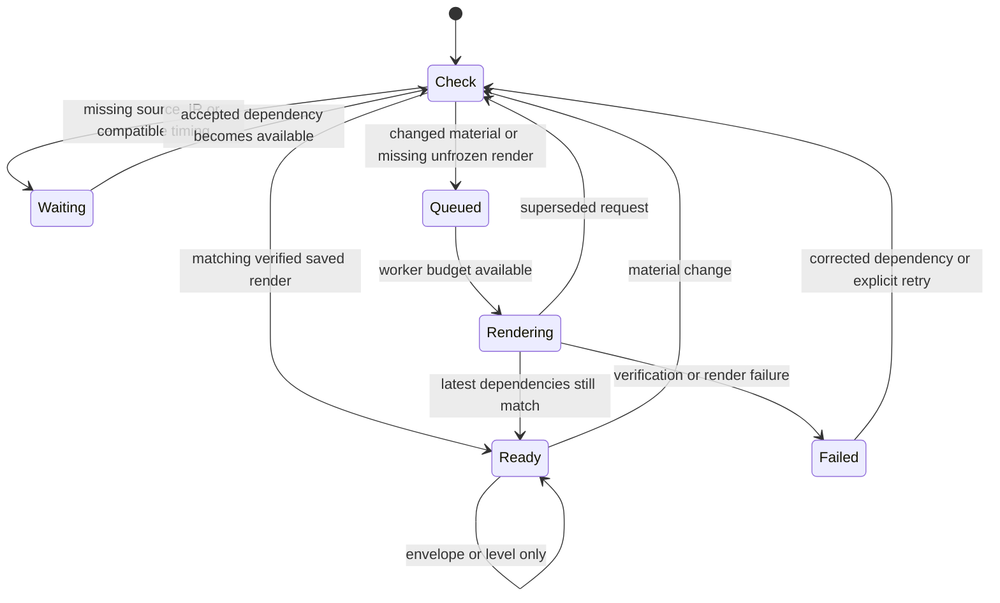

# Plugin architecture: source, markers and swell sounds

**Owner-approved architecture; implemented and verified on PR #31.** 2026-11-06. This replaces the recovery-only rendering approach discussed for issue #8 / PR #31. [Proposal](../../openspec/changes/archive/2026-11-06-separate-learning-from-swell-rendering/proposal.md) records the completed change. Canonical automatic-swell-processing and swell-regeneration specs are synchronized; the completed change is archived.

## Ownership

| Owner | Owns | Does not own |
| --- | --- | --- |
| Learn | Explicit source capture/recapture; optional event detection and review/application of markers | Whether an existing swell is allowed to have current rendered audio |
| Accepted project model | Stable swell IDs, source bounds, IR assignments, edits, Freeze and saved preferences | Worker execution, raw device buffers or filesystem maintenance |
| Swell engine | Dependency comparison; exact render reuse; queueing/rebuilding changed eligible sounds; truthful readiness | Capturing source, discovering/deleting markers, changing saved user intent |
| Perform | Sound editing, envelope/level/placement, monitoring, mixing and audition | Permission for the background engine to run; source replacement |
| Export | A coherent accepted mix/render snapshot and explicit file delivery | Creating markers, recording source or silently accepting stale wet audio |
| Asset storage/resolution | Immutable source/IR/full-wet assets; verification, exact backup/restore and availability events | Deciding marker policy, special recovery DSP, inferred durable-file deletion |
| Audio callback | Bounded capture-queue writes and playback of published/pinned audio | Disk I/O, FFT/convolution, source/IR verification, blocking or UI policy |

The engine runs independently of the selected screen. Its background work does not enable wet output in Learn, start playback, or bypass Export readiness.

## Component and data-flow diagram

There is no recovery-to-render command arrow. Re-learning publishes ordinary accepted source; the same engine sees changed dependencies and updates existing sounds.

## What is built under the hood

1. **Capture transaction.** Playback writes dry blocks to a bounded queue. The capture worker stages chunks, validates continuity/coverage and commits an immutable source snapshot at Stop. Cancelled, partial or rejected replacement cannot borrow missing coverage from the old map or replace its authority.
2. **Marker transaction.** Detection reads accepted source and can display provisional candidates without creating definitions. Detect events and the current Generate/Generate on Stop controls govern whether marker changes are applied. Turning them off preserves existing markers and their IR assignments.
3. **Material reconciliation.** A change to accepted source, a swell's assigned IR, its material source footprint, supported timing, or asset availability identifies affected swell IDs. A worker compares the required dependency identity with verified saved audio. Equal identities reuse exact audio; missing/changed eligible audio queues a job. This is event-driven, not repeated global disk scanning.
4. **Full wet generation.** A job pins accepted source, assigned IR and timing, prepares the IR, performs reverse convolution and writes an immutable full wet result. Selection/envelope controls do not decide whether it runs. A Default IR change affects future assignments; it does not silently reassign existing swells.
5. **Guarded publication.** Before becoming Ready, the job must still match session, swell ID, material generation and dependency identity. Superseded work cannot overwrite a newer edit or recreate a deleted marker. Failed work retains prior files and reports its blocker.
6. **Presentation and playback.** Fades, curves, level and pure wet placement derive shaped audio/pages from the full wet result. The audio callback consumes published snapshots and keeps old reader pins until safe retirement. Export pins its own coherent accepted inputs.

Conceptual interfaces are immutable snapshots/events: `AcceptedSourceSnapshot`, `SwellDefinition`, `RenderDependencyKey` and `RenderPublication`. Existing capture snapshots, dependency fingerprints and per-swell input/shape generations already provide most of these mechanisms. This is an ownership/scheduling correction, not a proposed replacement DSP engine.

## What changes a rendered sound

| Change | Expected engine action |
| --- | --- |
| Different accepted source samples used by this swell | Rebuild this affected unfrozen swell after complete coverage verifies |
| Identical recapture, different chunk UUIDs or context-only metadata | Reuse verified audio; no new convolution |
| Assigned IR content or required IR preparation changes | Rebuild affected unfrozen swells |
| Future Default IR changes | Preserve existing assignments; no rebuild solely for that setting |
| Source bounds or accepted material timing changes | Reconcile affected material using existing timeline rules; incompatible source rates/mappings wait with an explanation |
| Fade, envelope curve, level, name or selection changes | Reuse full wet audio; update only relevant presentation data |
| Pure wet placement changes | Shift derived playback, preserving extraction and detector anchors |
| Envelope extension beyond prepared source support | Genuine footprint extension: require real additional source, then reconcile; no padding or truncation |
| Valid compatible saved wet file becomes available again | Verify and reuse it exactly; no recapture/convolution/resampling |
| Unfrozen wet file missing, inputs intact | Rebuild through the ordinary engine |
| Frozen wet file missing | Wait for exact restoration or explicit unfreezing; never silently rebuild frozen sound |
| Engine upgraded but an older supported render is intact and inputs unchanged | Preserve exact saved sound; retain existing explicit upgrade policy |

“Material timing” is the accepted source/render timing, not every playhead movement. This proposal preserves current coordinate/timeline semantics and does not infer upstream DAW audio edits or silently retime markers.

## Lifecycle of one existing swell

Freeze is an explicit hold on the accepted saved sound, outside automatic replacement. Frozen metadata/bytes stay protected even if source changes; missing frozen bytes are not treated as an ordinary disposable cache miss.

## Recovery is dependency restoration

- On editor open, a modal warning reports missing assets and offers Locate/Restore plus normal Learn guidance. It cannot be dismissed by activating controls behind it. Metadata decode failure is distinct and cannot claim edits are intact.
- Locate/Restore verify exact identities/closure, copy without overwriting conflicts and reload the current arrangement. They do not adopt older backup edits, switch working roots or start a separate renderer.
- If source cannot be recovered, normal Learn with event detection off preserves existing markers. Explicit Recapture stages replacement source. Once complete source and required IRs are accepted, the ordinary engine updates existing unfrozen sounds automatically, without a Generate click and regardless of new-marker Generate on Stop.
- Partial/cancelled capture, missing custom IRs and incompatible timing remain explicit. Re-learning can sound different and cannot reconstruct missing Export/Playlist files.

## Implementation call paths

`CaptureWorker::settleWorkflowPass` accepts prepared source before invoking the processor commit/settlement handlers. Provisional chunks remain separate. `SwellEngine::captureCommitted` invalidates overlapping unfrozen material generations; `inspect` also compares accepted source-range revisions for restore/availability changes. Neither uses detection or legacy refresh policy for existing-render admission.

`reconcileRenders` in `AutomaticCoordinator.cpp` checks real coverage/assigned IR/compatible timing and moves eligible stale definitions into dependency checking. The serial engine worker calls it without an editor or workflow-screen requirement, including while a new pass stages against the previous immutable accepted source. Learn analysis and marker application still use their original workflow/configuration/transaction fences. Automatic extraction-window planning keeps its existing explicitly requested Perform rules.

`renderJob` pins the accepted source and assigned IR, fingerprints actual PCM, and compares source footprint, IR content and supported material timing against the saved render descriptor. Different chunk UUIDs/context-only changes do not imply different PCM. Unchanged supported legacy dependency keys reuse exact verified wet assets; explicit Regenerate bypasses reuse. Missing unfrozen wet files rebuild normally. A fresh instance can bootstrap the bundled default; restoring an explicitly empty Default IR does not synthesize a new assignment.

`SwellEngine::edit` retains input versus shape generations. `shapeJob` and playback-page preparation derive envelope/level/pure placement from full wet audio; a real source-support extension changes the material footprint. `renderJob` retains session/ID/input-generation checks, latest capture generation/fingerprint checks, memory admission and cooperative page service. The callback still only queues capture/consumes published audio; the 256 MiB worker budget and reader retirement remain authoritative.

An IR replacement can supersede an in-flight render while other swells regenerate. During headroom measurement for those other swells, a target owned by the replacement can contribute its verified accepted render if its source, response and timing still match. Its superseded Checking phase does not hold the other renders open. The replacement still settles through the staged handover.

`PreverbAudioProcessor::setRecaptureExisting` can explicitly arm complete-known-coverage source replacement only from Learn. `beginSourceReplacement` releases the obsolete expected-source-reference barrier; it does not request DSP. The normal accepted-source notifications then drive maintenance. `reloadRecoveredAssets` verifies session/closure and reloads dependencies without adopting backup creative edits. The editor's owned modal and Storage callbacks resolve files, not rendering policy. No recovery-specific renderer remains.

Native owner interaction approval and full integration/profile verification are recorded in [dated evidence](../validation/2026-11-06-shared-swell-engine.md). Implementation does not waive later folder-association, cleanup or release gates.

## Guardrails and review decisions

Keep stable host/state identities, supported legacy readers and saved preference values. Change the behavior described above explicitly; do not reinterpret a legacy off flag as permission for marker creation or recording. Preserve compatible exact saved renders, indefinite durable history and all portability/association/cleanup gates.

Use bounded worker scheduling and the existing 256 MiB working budget. Prioritize active playback page service, coalesce rapid updates and avoid rendering unaffected swells. No automatic transport/audition. No silent source resampling to mask incompatible capture. No automatic engine-version sound upgrades.

For agreement: Learn owns source/marker creation; Perform owns sound interaction; the engine owns material readiness even while Learn is selected or the editor is closed. Detection off means no new markers, not stale existing sounds. Freeze remains the explicit exception. Recovery only restores those ordinary dependencies.
