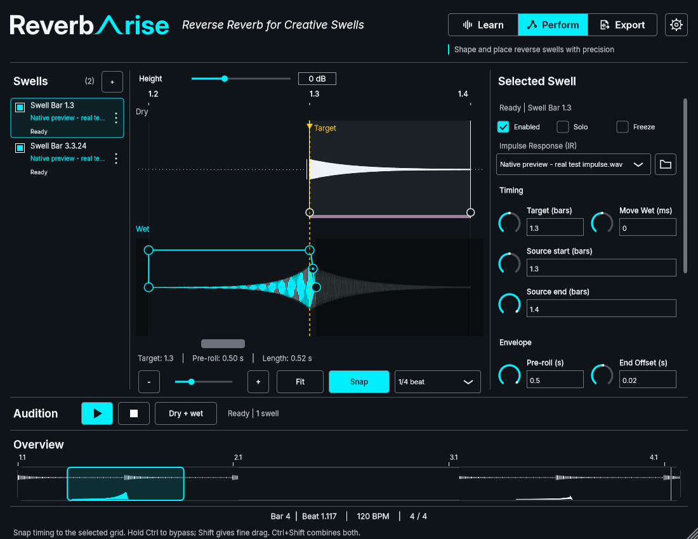

# Issue #46 — bottom hover-help checkpoint

4 November 2026. The owner replaces intrusive floating tooltips with one plugin-wide
help line below the musical-position footer. All controls with existing hover
help use this area, including graph regions, nested fields, Learn/Perform/Export
and owned Settings/Diagnostics windows. Metadata remains on the controls; a
recursive editor listener selects the nearest message. Interactive title/name
is a fallback, not a second control implementation.

The footer reuses EllipsisLabel, normal Inter Regular 14 helper typography and
the existing 20-pixel feedback height. Long text ellipsizes without condensing;
the full message is also its accessible description. No new font/geometry token
or graph overlay is introduced. The row uses bottom padding and four unused
pixels of the Perform position band at minimum inset. Learn/Export body bounds
finish above it (at most four pixels less available height); no Export domain
behavior or shared control API changes. The three columns and proposed 52-pixel
audition strip are preserved. Actual visual acceptance/adoption remains task 5.4.

## Validation

Warm Windows MSVC Release build, pinned JUCE 9.0.4, existing build tree
`out/build/windows-msvc`; targets `preverb_perform_composition_preview` and
`preverb_swell_ui_test`. Build-support cache checks and per-directory lock held
through build/CTest; no overlapping wrapper operation or cache reset.

**10/10 focused native CTests passed, 41.92 s:** swell UI, Perform navigation,
gestures, bindings, knobs, resets, audition, audition strip, readability and new
hover-help coverage. Logs: `out/build-logs/Release/20261104-hover-footer-build-v3.log`
and `20261104-hover-footer-tests-v3.log` in the same directory.

The new test verifies visible provider metadata routing, list/graph context,
normal font/bottom bounds, retaining text while reading the footer, exit and
destroyed-source clearing, owned Settings control routing, all three modes at
four sizes, and zero host-dirty/render/source/capture/navigation mutations.
Existing focused tests retain exact editing, scrolling, ruler alignment, scaled
geometry and gesture/binding coverage. Hover adds no timer, layout or model work;
SafePointer checks protect source lifetime. Dynamic help refreshes with state.

Initial compilation caught a const qualifier on JUCE's non-const getTooltip test
API; corrected. The first executable run then caught stale help after its source
was destroyed: refresh now clears the footer even when SafePointer is already
null. The complete focused selection passed after both fixes.

UI standards: **47 files / 61 bounded occurrences**, unchanged debt inventory.
Strict OpenSpec: **20/20 items**. Diff checks pass. The prior complete audio/state/
Export Release baseline remains [55/55 at 4e7aff9](2026-11-04-issue-46-audition.md);
it was not rerun for this UI-only change and is not described as a new full run.
No audio callback, durable state, shared ActionButton/ruler or Export implementation
changes. FL Studio and actual Windows DPI validation of this revision are untested.

## Native review

Prepared executable: `out/review-issue46-hover-footer/perform-hover-footer.exe`.
SHA-256: `081994E3335B30C7C226549E077FB5D7BD0129FC2E56420F680DC5B1DD443F94`.
Capture command: `--capture-audition-strip out/issue46-hover-footer-captures-v1`;
selected/empty/dense and Snap-hover images generated, hover image inspected.
The directly launched window uses `--review-audition-strip`, retaining title
“Issue #46 - Audition strip layout checkpoint” and “Perform clarity checkpoint”
review strip. It has no audio device. The earlier completed review window was
replaced; this checkpoint stays open for owner review.

OpenSpec remains **19/21**, pending visual acceptance/adoption (5.4) and final
host acceptance (6.2). Previous layout/Snap/knob/audio evidence is retained. The
host-test VST3 bundle remains unchanged; this is the revised native presentation.
