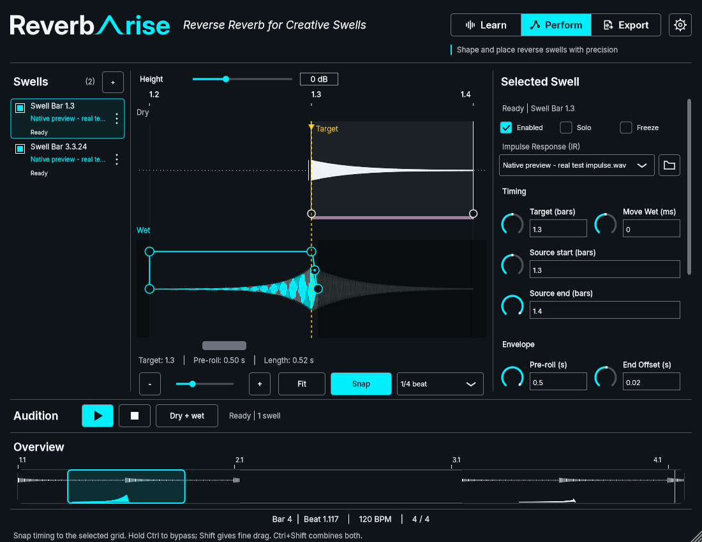

# Issue #46 — approved presentation adoption

## Final owner host acceptance

On 4 November 2026 the owner answered **“Host smoke passes”** for the exact
`issue46-presentation-31a969b-20261104-220251` bundle documented below. This confirms
FL Studio audition looping/Stop, Dry + wet versus Wet only listening balance and
save/reopen. Earlier native presentation and editing approvals remain recorded.
No additional Windows DPI setting, host version or wider DPI matrix was supplied;
those are not inferred from the host pass. The later [main reconciliation](2026-11-04-issue-46-main-reconciliation.md)
retains this acceptance against its original bundle and records the combined
build separately; it does not claim a new owner run of that binary.

Task 6.2 is now complete. Guarded task editing and refreshed Apply confirm
**21/21 tasks complete**. The earlier pending-host statements below describe the
build handover before this response. PR #48 remains for owner review/merge;
OpenSpec sync/archive and issue closure have not been performed.

The owner answered **Approve revised presentation** on 4 November 2026 for the
[bottom-help native checkpoint](2026-11-04-issue-46-hover-footer.md). This accepts
the revised three-column presentation and 52-pixel audition strip before rollout.

Production now uses that profile directly: inline audition status/equal gaps,
grouped Timing/Envelope/Level inspector with full Source labels and reachable
reset rows, compact readouts retaining exact editing, shared musical ruler,
concise annotations, readable musical footer/aligned headings, and normal-font
bottom context help for all existing hover providers. The temporary preview-only
flag and legacy presentation branches are removed. Standards revision 5 records
the scoped approval. No stored precision, schema, audio callback or Export-domain
behavior changes are introduced by adoption.

Native strip/readability/hover cases now construct the ordinary production editor;
there is no helper call that can conceal a production/preview difference. The
strip test's obsolete “production stays 72 until approval” assertion is replaced
with direct 52-pixel/default lane-bounds assertions. Existing geometry, interaction,
precision, mode, persistence and audio checks remain.

## Final validation and identity

Final source: `31a969b08093ade674ffaa18b28a08258c1ba080`; production adoption is
`cc9695c`, followed only by regression assertion/discovery improvements. Warm
Windows MSVC Release, pinned JUCE 9.0.4, existing caches and build-directory lock.

- Full `scripts/build.ps1 -Configuration Release -Test`: build passed; **55/58**
  tests passed in **172.34 s**, logs `out/build-logs/Release/20261104-215542-02c01932`.
  Failures were three obsolete presentation expectations: 72-pixel preview gate,
  fixed curve decimals, and compact field/accessibility text equality. Updated
  assertions retain exact model/accessibility value checks and verify the
  approved compact display separately. No production behavior changed for them.
- Corrected focused run initially passed 9/10, exposing the reset test's fixed
  40 ms popup-discovery delay. Replaced it with bounded message-loop discovery
  (up to 500 ms), retaining real menu selection/location, reset and stale-action
  assertions. Isolated reset then passed; no production reset code changed.
- Final `scripts/build.ps1 -Configuration Release`: **PASS**, clean source
  `31a969b`, logs `out/build-logs/Release/20261104-220251-1ff889fc`. This build did
  not itself request CTest. Immediately afterward the full affected selection
  passed **10/10 native CTests in 46.39 s**, log
  `out/build-logs/Release/20261104-adoption-tests-final.log`. Thus all 58 unique
  tests have passing coverage across the full and corrected focused runs; this
  is not represented as one 58/58 wrapper run.
- UI standards **47 files / 61 bounded occurrences**, unchanged inventory;
  strict OpenSpec **20/20**, diff checks pass. No cold setup/cache reset.

Final production selected/empty/dense and Snap-hover captures were generated with
`--capture-integrated out/issue46-production-captures-v1`; the hover image was
inspected and matches the approved presentation. The directly open
“Issue #46 - Integrated Perform review” uses the ordinary production editor,
without a presentation switch or audio device. Executable
`out/review-issue46-production/perform-production.exe` SHA-256:
`8E58857785897776E41A41B528EAAB6BF45B00ECCF54F66A132CFC3B894C9F1C`.

Complete internal FL Studio test bundle, all six files copied/hash-verified:
`C:\Users\neila\.codex\worktrees\670e\k7ma-preverb\out\host-smoke\issue46-presentation-31a969b-20261104-220251\ReverbArise.vst3`.
The adjacent manifest records source/build logs and every file hash; README.txt
contains the brief final check. Inner VST3 SHA-256:
`EABD319D9C0EA54FB68E4EF5EB22A4E84AAEF6FF4FCEAF172F24E4E53BDA4F4F`.
No installed plugin or previous host bundle was overwritten.

Task 5.4 is complete after owner approval, production adoption and validation;
exact task-line guard and refreshed Apply confirm **20/21**. Only 6.2 remains:
final FL Studio audition loop/Stop, selected listening balance and save/reopen,
plus observation of the approved presentation in-host. Earlier editing approvals
stand. Final host listening and actual Windows DPI are not claimed by native or
software-scale tests. No issue closure, self-merge or OpenSpec sync/archive.
