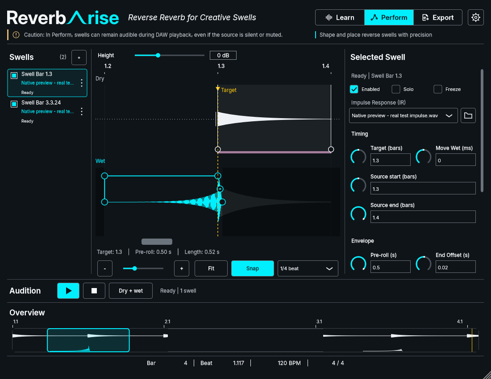

# Issue #68 transport readout validation

## Scope and execution map

OpenSpec: `stabilize-perform-transport-readout`. Branch:
`codex/68-stable-transport-readout`, based on main `84894ee`.

- Tasks 1.1/1.2: medium-risk GUI formatting/component work; component geometry,
  actual glyph fit, availability, rounding, accessibility and software-scale checks.
- Task 1.3: native owner presentation review; prerequisite for production integration.
- Task 2.1: medium-risk editor bindings; native refresh/mode and state-invariance checks.
- Task 2.2: low-risk guidance/standards/currency work after acceptance.
- Tasks 3.1/3.2: integrated native verification and review delivery.

The candidate component retains existing footer typography (15-logical-pixel
embedded Inter Regular), primary text ink and existing spacing. It adds no
highlight/background, interaction, transport or DSP behavior. Independent field
geometry and bounded overflow replace value-dependent combined-text centring.
See [component policy](../development/transport-readout.md).

## Environment and preparation

Windows x64, VS 2026/MSVC, Windows SDK 10.0.26100, pinned JUCE 9.0.4 and WavPack
5.9.0. This worktree began without a build tree. The initial configure explicitly
points FetchContent source overrides at existing pinned source directories in
`C:/git/k7ma-preverb/out/build/windows-msvc/_deps/`; build products stay in this
worktree. No cache is copied, cleared or modified in the source checkout.

Initial sandboxed configuration failed because MSBuild could not read the Windows
SDK registry. Elevated retry completed using the same local sources, with the
per-directory build lock held throughout. Logs: `out/transport-initial-configure.log`
and `out/transport-initial-configure-elevated.log`.

## Verification status

UI standards passed with 53 scanned files and 61 unchanged bounded occurrences.
Strict scoped OpenSpec validation and `git diff --check` pass.

The first Release wrapper run (`out/build-logs/Release/20261105-215536-2952bb22/`)
compiled shared/plugin/VST3 targets but was explicitly interrupted while building
unrelated tests to bring the native review forward. This is **not** a full wrapper
build pass or full CTest result. Its child processes stopped before focused work;
other chats' independent build processes were left untouched.

With the directory idle and its build lock held, the focused native Release target
`preverb_transport_readout_test` built successfully (two build workers); logs:
`out/transport-focused-build.log` and `out/transport-focused-build-final.log`.
Native CTest `^preverb_transport_readout_test$`: **1/1 PASS**, 0.75 s total
(0.70 s test), including supported 1100x850, 1400x900, 1400x1000, 1600x1000
logical footer widths and software 100/125/150/200% rendering. No generic speedup
claim is made. Initial dependency configuration/source reuse does not make the
first compilation a warm build; the corrected test-only rebuilds were incremental.

Two harness failures were corrected: the initial synthetic position fixture changed
samples without advancing PPQ, and the first accessibility assertion dereferenced
a null handler without a native peer. The fixture now supplies consistent host
coordinates, creates the required desktop peer and explicitly verifies a non-null
handler. These failures do not establish a production transport defect.

Evidence: 35 distinct PNG files in ignored `out/transport-readout/` (the two 1400-wide
footer overflow cases share identical dimensions/output), plus CTest's LastTest.log.
Normal-limit, unavailable and bounded-overflow screenshots were visually inspected
at the minimum width. Full text remains in static-text accessibility and help.

Reviewed preview executable SHA256:
`f3c3ca21f18d75a9335fef61e488fb3ef084c5c20e041c9c12255263222d9f6a`.
Native interactive `--review` preview launched directly (PID 63704). It cycles
synthetic playback values and offers limit/unavailable/overflow cases. Explicit
owner look/feel acceptance was received on 5 November 2026: **“Approve look and feel”**,
specifically for spacing, readability and stability as values change, and integration
into Perform. This accepts the scoped footer extraction and fixed-slot presentation;
it is not FL Studio or physical DPI acceptance. The review window was preserved
through acceptance and can now close before relinking the executable.

No production editor integration, plugin installation, FL Studio test, physical
Windows DPI/multi-monitor review or owner acceptance is claimed at this checkpoint.

## Approved production integration and final validation

This section supersedes the checkpoint's pending-integration/acceptance statements.
The approved control now replaces the production `hostInfo` Label. The editor
submits existing transport snapshots without changing transport, processing,
capture, saved state or identity mechanisms. The existing 15-pixel embedded Inter
Regular, primary ink and spacing are retained; standards revision 6 documents the
accepted extraction. The old editor font-construction inventory count is manually
reduced from 12 to 11 for its one removed occurrence; no inventory regeneration.

Commands and final results, at **`9cb9956` plus the integration diff (dirty)**:

- `$env:CMAKE_BUILD_PARALLEL_LEVEL='4'; powershell -NoProfile -ExecutionPolicy Bypass -File scripts/build.ps1 -Configuration Release -Test`:
  **PASS configure/build/test**, **72/72 CTest**, **207.82 s**. Final logs:
  `out/build-logs/Release/20261105-223707-8db39305/`. This is native Windows/MSVC
  Release build evidence; the registered CTest suite includes native executables
  and command fixtures, not 72 separate in-host tests.
- The preceding integrated run passed 71/72 in 203.09 s; its sole failure was
  `preverb_perform_hover_help_test` casting `hostInfo` to the retired Label type.
  Its bounds-only check now requests `juce::Component`. No production behavior
  changed for that correction. Prior log: `20261105-221734-a7a89afd`.
- Direct native `preverb_perform_composition_preview --test-readability` passed
  before the final suite. Actual processor snapshots exercise bar 9/10 and
  99/100 forward/back seeks, tempo/meter changes, missing timing, all supported
  sizes, exact-position help and mode return. Encoded session, capture revision
  and render count remain unchanged. The final suite includes this test and the
  focused readout test; earlier focused results are not additional final coverage.
- `scripts/check-ui-standards.ps1`: **53 files / 60 bounded occurrences**, PASS.
- `openspec validate stabilize-perform-transport-readout --strict`: PASS;
  repository-wide normal `openspec validate --all`: **19/19**. Eight existing
  canonical description-length warnings remain; global strict passing is not claimed.
- The maintain-user-guide review found no changed user steps or controls requiring
  new prose/screenshots. Existing illustrative guide images and instructions remain
  accurate. Explicit review/currency commands passed using PowerShell 7 and the
  checkout's explicit `-Root`; supplying Root avoids the observed PowerShell 5.1
  default-parameter resolution failure. Guide currency is not a native/host test.
- `git diff --check`: PASS.

First test compilation was cold in this worktree with reused dependency sources;
the final correction rebuild reused the now-populated build tree. No performance
comparison or speedup is claimed.

`preverb_perform_composition_preview --capture-integrated out/issue-68-integrated`
captured the real editor's selected/empty/dense and hover-help scenes. The
minimum-size selected and hover-help captures were visually inspected: information
is contained above context help and clear of Overview. Supporting image:

**NOT RUN:** fresh Debug, installed FL Studio smoke, physical Windows DPI or
multi-monitor transitions. Software-scale and native fixture results do not certify
those environments. No concrete unresolved host behavior requires another owner
edge-case session for this GUI-only fix. No VST3 installation, user project/asset
change, sync/archive, merge or independent issue closure was performed.

Follow-on #58 owns its separately requested 900x600 combined review. This change
retains the existing supported-size contract. Shared integration points are
`Controls/TransportReadout.h`, `TransportPresentation.h`, `PluginEditor.h/.cpp`,
the Perform tests and production standards revision 6.

Delivery: [PR #95](https://github.com/elneilios/ReverbArise/pull/95), targeting
main from `codex/68-stable-transport-readout`, open and mergeable at verification.
Implementation source is committed as `331c424`; the final delivery commit changes
only this record and task tracking. Refreshed vanilla Apply reports **7/7** and
`all_done`. Native tests are not repeated for that documentation-only closeout.
