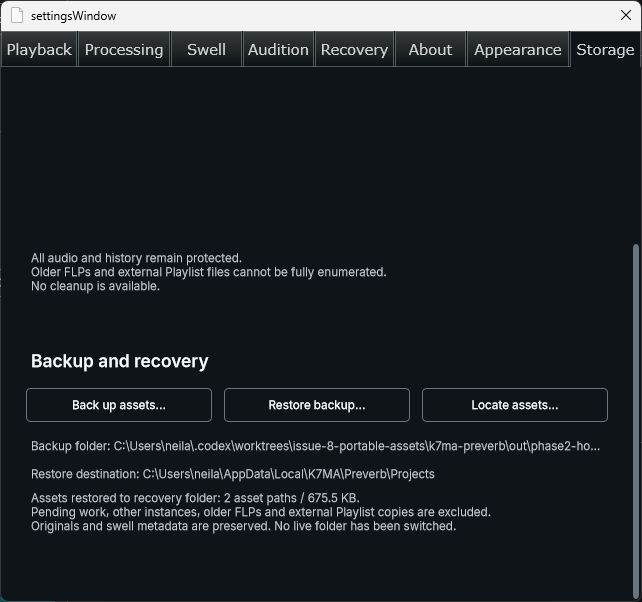

# Issue #8 FL Studio Storage smoke retry — 2026-11-06

The owner requested retrying the FL test after the earlier UAC cancellation. Tested production revision **407df25471734642902bf1f14e9076c73e8431cb**, clean branch `codex/8-portable-asset-design`, PR #31 / OpenSpec `portable-project-assets`. The scoped task 3.9 host smoke passed. This does not complete phase 2: task 3.8 isolated-profile recovery and task 3.10 missing-asset recovery remain open.

## Build and installed identity

Used the documented `install-test-vst3` workflow and hidden Windows-elevated launcher after checking FL Studio was closed. The owner accepted UAC this time. `scripts/install-test-vst3.ps1` ran the normal plugin-only Release build through the repository wrapper/lock and installed the complete bundle with its existing staged SHA-256 checks. No manual copying, ACL changes, diagnostic probe or release packaging.

- Release configure/build: **PASS**, clean Git `407df25`; logs `out/build-logs/Release/20261106-134230-72bec237`. Warm build/dependency caches reused; no cold speedup claim.
- Installed bundle: `C:/Program Files/Common Files/VST3/ReverbArise.vst3`.
- DLL SHA-256: `75e179adf80bdaaa244c415cb2fd8905ad8b8b30eb4c7a101238b25033030f48`.
- Previous complete bundle retained at `out/vst3-install-backups/20261106-134243-9bafb5f9ee214d0b965bccca7323638e/ReverbArise.vst3` in this issue worktree. The new production test build remains installed; no rollback was requested.
- CTest was not requested or rerun by the installer. No source changed since the separately recorded affected **8/8 native tests** and screenshot-harness **1/1** results.

Actual host: **FL Studio 2026, 26.1.7 build 5654**, Windows x64 / JUCE 9.0.4. Read-only process module inspection confirmed the loaded DLL came from the installed system bundle above; the existing registered entry loaded it. No new plugin-manager rescan was needed or claimed. Windows/UI-scale permutations and a second PC were not tested; the Settings capture is 642 × 602 logical capture pixels, with comfortable controls and working viewport scrolling. OS DPI was not independently measured.

## One consolidated disposable-project check

1. Opened the previously created diagnostic fixture FLP with one ReverbArise instance on Master. It contains **no song audio or swells**; this exercises the managed default IR and descriptor, not listening acceptance. No user song was opened and transport was not played.
2. Opened Settings → Storage. The automatic scan completed; the user-data instance root remained authoritative and the page reported two managed IR/descriptor paths.
3. Pressed Back up assets, used the native picker to select the newly created empty `out/phase2-host-smoke/backup`, and observed **Backup complete: 2 asset paths / 675.5 KB**. The receipt reports exactly **691,757 logical bytes**, the included project/instance IDs and excluded pending/other-instance/older-FLP/external-Playlist scope. Schema-1 historical context remains explicitly unknown.
4. Saved a new FLP copy in `original/portable-smoke.flp`, then used FL Studio Save As to `save-as/portable-save-as.flp`. The original fixture FLP was not overwritten. No folder migration or live association occurred.
5. Duplicated that newly saved FLP to `transferred/portable-duplicate.flp` and copied the complete backup tree to `transferred/assets`. Both FLPs have identical SHA-256 `4378c96cc3d8b52a2a209fa10b279e995693fbcdd93f291e65e0be1036539222`; all **six** backup files have identical hashes in both trees. This is filesystem/project duplication, not an in-host plugin-instance clone or independent writer-branch test.
6. Reopened the transferred duplicate in FL Studio, opened Storage and pressed Locate assets. With no in-memory backup locator, explicitly selected `transferred/assets/receipts/3b25fdddd41d9bb1c0951af317ecd1898ba688e19727c9ea510abef9fc369773.json`. Observed **Backup verified: 2 asset paths / 675.5 KB**.
7. Pressed Restore backup, selected the now-known transferred backup folder, and observed **Assets restored to recovery folder: 2 asset paths / 675.5 KB**. The destination was the current user-data Projects root. This is an **idempotent same-profile restore with originals available**, not missing-file or fresh-profile recovery. Both original alias hashes still match the exact backup snapshot afterward, and the duplicate FLP hash remains unchanged.

The [machine-readable report](2026-11-06-issue-8-fl-studio-storage-smoke.json) records the full receipt, all six transferred-file hashes, duplicate hash, binary identity and coverage limits. The disposable files remain under ignored `out/phase2-host-smoke`; no user asset was moved or deleted. The final disposable project and its Settings result are left open for inspection.

## Safety gates and operator guidance

The [operator procedure](../development/portable-asset-backups.md) remains: back up each participating instance, retain its exact receipt, transfer the entire backup folder and separately save/copy the FLP and external Playlist audio. Repeat for every instance; this one-instance smoke does not certify a whole project, unknown older FLPs or absent instances. Missing/invalid dependencies or incomplete transactions must not be treated as complete recovery. Existing originals and rollback copies remain protected.

Fresh-profile missing-source admission/reload and Re-learn are still not delivered. This smoke does not waive isolated-profile validation, change the user-data fallback, establish writer-branch independence, or authorize association/cleanup/compression. Earlier dated reports of the canceled installation remain historical evidence; this report supersedes only the outstanding scoped FL Studio smoke status. Strict OpenSpec validation, guide currency, links, staged whitespace and guarded task-progress confirmation are checked before delivery. No source changes required another native regression run.
