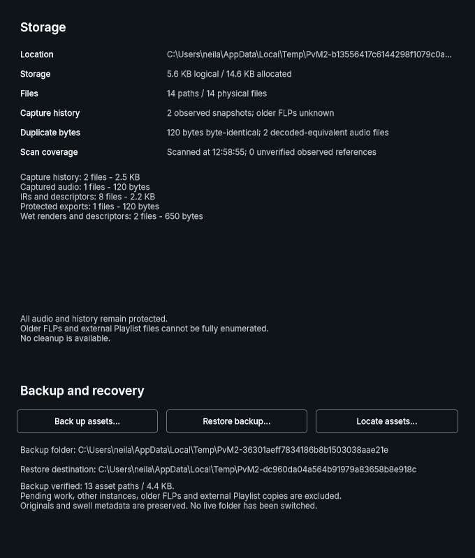

# Issue #8 phase-2 backend and native review — 2026-11-06

Implementation on `codex/8-portable-asset-design`, based on `8fe2a6510ff36beadbe48cab6f5a4b60542b6579`; the commit containing this report identifies the tested source changes. OpenSpec `portable-project-assets`, PR #31. The owner authorized phase 2 with explicit folder selection and user-data fallback. Tasks 3.1–3.6 are implemented; 3.7 remains at native-preview approval. This is not phase-2 completion or production Backup/Restore rollout.

## Environment and commands

Native MSVC Release on Windows NT 10.0.26300 x64, Visual Studio 18 Community, pinned JUCE 9.0.4 and existing WavPack dependency. Reused the issue worktree's build tree and shared pinned dependency sources. New GUI/test targets initially compiled native modules; no cold-build speedup is claimed. Every CMake/CTest operation held the repository build-directory lock; the wrapper ran separately after lock release.

- Configure: `cmake --preset windows-msvc -DFETCHCONTENT_UPDATES_DISCONNECTED=ON` using the existing pinned JUCE source override.
- Build: `cmake --build --preset windows-msvc-release --target <the 16 affected targets> --parallel 4` under the lock. Logs: ignored `out/phase2-regression-build.log`.
- CTest: `ctest --preset windows-msvc-release --output-on-failure -R <exact affected-test expression>` under the lock; **16/16 passed, 57.32 seconds**. Exact names/results are retained in the adjacent compact text report copied from `out/phase2-regression-tests.log`.
- Production VST3: `scripts/build.ps1 -Configuration Release -PluginOnly`: **PASS**, configure/build exit 0; tests ran separately. Wrapper log `out/build-logs/Release/20261106-125505-e177ba0a`.
- `scripts/check-ui-standards.ps1`: **PASS**, 63 files, existing 60 bounded occurrences unchanged. `git diff --check`: PASS. Strict OpenSpec, guide currency and relative-link checks are recorded with delivery below.

## Native fixture evidence

`preverb_portable_assets_test` exercises bounded independent versions/unknown fields, legacy aliases and metadata preservation, every required source/context/default/library/render/export dependency, schema-1 unknown provenance and zero-swell historical-context IRs. Missing saved export history prevents a complete backup. Signed-zero-distinct WAVs remain byte-distinct objects. Repeated and simultaneous writers reuse only verified identical bytes; original file hashes remain unchanged.

Fault checkpoints cover every WAV/descriptor publication and snapshot/completion receipt. Cancellation, inspection and explicit-source resume retain prior complete backups. A native write-error seam injects Win32 ERROR_DISK_FULL (112) after 65,536 bytes; the owned partial staging file is present, no complete receipt is published and resume succeeds. This is injected disk exhaustion, not a physically full disk. A deny-add-file/subdirectory DACL on a disposable destination exercises actual read-only failure and is restored before fixture cleanup. Locked metadata and absent/offline roots fail conservatively.

Physical C: → D: copy uses an explicitly created disposable root (`PREVERB_PORTABLE_CROSS_VOLUME_ROOT`); the fixture asserts distinct native volume serials before the copy. Traversal/reserved/device/UNC/drive-relative/ADS/case-conflict inputs fail. Real NTFS source/destination/ancestor junctions and replacement races preserve the outside sentinel. A directory renamed while pinned is blocked; converting an empty destination directory in place into a junction is rejected by rooted publication. Unicode selected folders include accented characters and a supplementary-plane character. Paths beyond the 240-UTF-16-unit policy fail explicitly.

Moved backup copies verify by exact locator rather than original absolute path. A conflicting store copy with the same UUID fails without damaging the good copy. After releasing source pins, the fixture moves the original source offline and restores into another disposable root; all dependency hashes match and existing capture/IR/render readers verify restored fixtures. Repeated identical restores succeed; conflicting destination bytes are retained. **This runs in the same Windows user profile and does not satisfy task 3.8's isolated-profile gate.**

`preverb_portable_snapshot_test` uses the real processor and synthetic audio. It verifies stopped-host accepted-state pinning, concurrent A/B state replacement, capture publication, IR imports and explicit rendering without mixing source/creative epochs. Snapshot reads do not themselves increment render activity, alter source or state. Pending work is not included as completed output.

`preverb_portable_storage_panel_test` presses the actual Backup/Locate/Restore bindings and checks resulting copies, bounds, picker cancellation, hidden-page callbacks and root/runtime-epoch changes. The final screenshot below comes from the compiled candidate, with no production Settings integration. The review executable runs from a hash-named ignored copy so the review window can remain open without locking future build output.

## Limits and remaining gates

No isolated Windows profile, second PC, new FL Studio transfer/audio/DPI smoke, Debug run or full CTest suite is claimed. No release, host installation, live-root switch, saved locator adoption, Re-learn recovery or cleanup was performed. Byte/metadata/closure verification is distinct from arbitrary WAV playback/readiness validation. The original user-data fallback and production writers remain unchanged; phase-4 association/writer ownership needs its own gates. Native preview approval precedes task 3.7 production control integration. Tasks 3.8–3.10 remain unchecked; durable assets and prior FLPs remain protected.

Living API/format/path/recovery details: [portable backup backend](../development/portable-asset-backups.md). Earlier phase-0/1 and FL Studio discovery evidence remain unchanged.

Delivery checks: strict `openspec validate portable-project-assets --strict`, explicit semantic guide review followed by read-only currency check, UI standards and relative links all passed. Refreshed guarded Apply queries confirmed each task 3.1–3.6 independently, reaching **16/36**. The final screenshot writer truncation fix passed its affected native CTest again (**1/1, 0.88 seconds**). The opened review binary SHA-256 is `f21071f28a5349dddcee9389a2e12fa496d64c55552d5f43bb9cecd4f8327569`; native window creation was verified. Owner look/interaction acceptance is pending.
