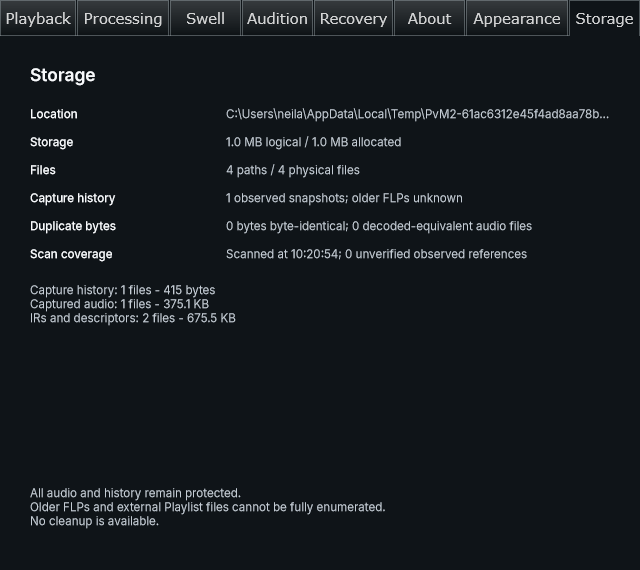

# Issue #8 — production Settings integration, 2026-11-06

The owner approved the native Storage preview and automatic page-open flow: “ok looks good, what's next?” Phase 1 now integrates that approved composition into the actual Settings window. Later Pack/Relink, association, migration, writer, compression and cleanup phases remain separately gated.

Storage observes only the current instance's managed root and accepted capture/creative references. It starts one read-only worker scan when shown, cancels/clears on hide, and rescans on reopen. Stop scan never starts a retry. A changed session identity/epoch clears and replaces the scope; inconsistent reference acquisition reports uncertainty. The worker starts lazily and parks while idle. Existing About/Appearance tab positions remain unchanged. All assets remain protected; reclaimable bytes remain zero.

## Native verification

Windows/MSVC Release, existing warm `windows-msvc` build/dependency cache, under the repository build lock. Tested worktree based on `58488151544ad7c97048aa9a2f631c8688d34d82` plus this integration commit. No cache clearing or cold-run speed claim.

- Built `preverb_storage_settings_test`, `preverb_swell_ui_test`, `preverb_asset_inventory_test` and `preverb_storage_inventory_preview` with CMake Release preset, parallel 4.
- CTest Release regex `^preverb_(storage_settings_test|asset_inventory_test|storage_inventory_panel_test|swell_ui_test)$`: **4/4 passed**, 13.55 seconds. Log: `out/phase1-integration-test.log` (local ignored output).
- The actual Settings harness verifies base/responsive tab positions, inactive hidden pages, scan-on-open, accepted dependency closure, reopen/hide, changed-session scope replacement and return to the original session. Serialized state, source reference, render counts and asset hashes stay unchanged. Fixtures use disposable temporary roots, not user audio.
- The first harness run overflowed the Windows stack before its body because large processor/editor objects were local values. Using owned heap objects, as existing UI tests do, corrected the harness; all four checks then passed. No product crash was inferred from that harness failure.
- `scripts/build.ps1 -Configuration Release -PluginOnly`: **passed**, production VST3 linked. Wrapper log directory: `out/build-logs/Release/20261106-102116-f5e764a4`. CTest was run separately above; the wrapper did not request tests.
- Final UI standards, explicit guide review/currency, strict OpenSpec validation and whitespace checks passed as recorded with this delivery.

The screenshot is the actual Settings component tree, captured by the native harness. Visually reviewed for readable labels, unclipped tabs/counts/protection text and ellipsized location with full accessible text. It is supporting evidence, not FL Studio or complete DPI validation. No full native suite, Debug, FL Studio, second-PC, UNC/long-path success or full DPI matrix is claimed. No binary installation or release packaging was performed. Cooperative scan limits still cannot impose a hard deadline on a blocking OS call.

See [implemented inventory guidance](../development/asset-inventory.md), [prior backend/preview evidence](2026-11-06-issue-8-inventory.md) and [approved compatibility/backup rules](../development/asset-storage-contracts.md). Optional runtime host-path spike remains unperformed; explicit-folder fallback remains the later portability design.