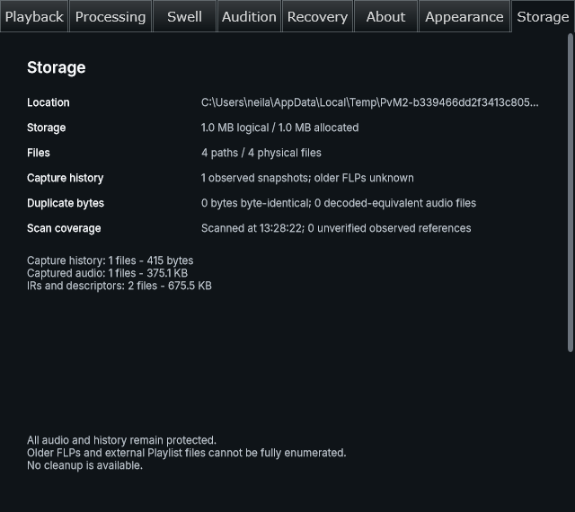
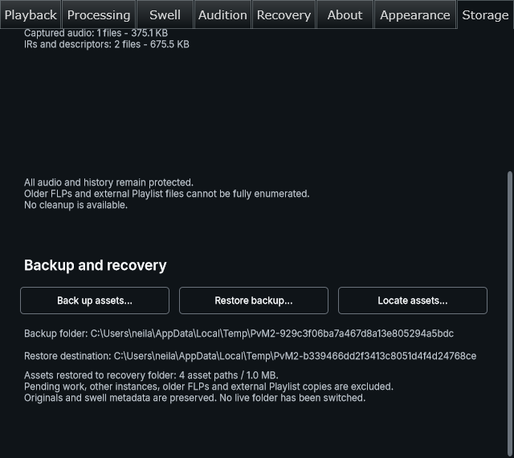

# Issue #8 approved production Storage actions — 2026-11-06

Owner acceptance: "looks fine, carry on", following the functional native Backup/Restore/Locate review at `87333e5310c6857286cf002d1c79e5d5564ecdbd`. This report covers the subsequent integration commit containing it. OpenSpec `portable-project-assets`, PR #31; task 3.7 is implemented. Earlier phase-0/1/backend evidence is preserved rather than rewritten.

## Production behavior

Settings → Storage composes the approved inventory and Backup/Restore/Locate actions. It retains automatic scan-on-open and original tab positions. A shared focus-revealing viewport preserves comfortable control sizes within the existing Settings window. Scrolling exposes Backup and recovery; no token/variant or Learn control changes were introduced.

Backup pins accepted metadata and copies/verifies exact closure in a selected folder. Reopening no longer requires first creating a new backup: an explicit native receipt-file chooser selects `receipts/<snapshot-hash>.json`. The backend reads that receipt through pinned-root containment, verifies its exact filename/store/snapshot and all dependencies, and never chooses a newest snapshot. Known locators can select their matching moved backup folder. The UI rejects a valid backup of another project/instance before copying. Restore copies aliases into the displayed projects root, preserving conflicting files and the current creative/capture state. No association or saved-state format changes were made.

The controls establish scope through the available accepted-source getter. Missing-source admission, automatic reload and Re-learn are task 3.10 work, still gated. Thus these copy/verification actions alone do not establish a working fresh-profile recovery flow; no successful live recovery or complete phase-2 portability is claimed.

## Native verification

Windows NT 10.0.26300 x64, MSVC Release / Visual Studio 18 Community / JUCE 9.0.4. Reused the existing issue-worktree build tree and shared pinned dependencies under `Enter-BuildLock`. The new presentation-policy target initially compiled its JUCE core dependency; no cold-build speedup is claimed.

- Eight affected targets built under the repository lock. CTest exact expression selected `preverb_presentation_policy_test`, `preverb_swell_ui_test`, `preverb_asset_inventory_test`, `preverb_storage_inventory_panel_test`, `preverb_storage_settings_test`, `preverb_portable_assets_test`, `preverb_portable_snapshot_test` and `preverb_portable_storage_panel_test`: **8/8 passed, 18.36 seconds**. Adjacent text report retains names/results. Ignored logs: `out/phase2-integrated-regression-build.log` and `out/phase2-integrated-regression-tests.log`.
- Production Settings binding test presses real Backup/Locate/Restore actions, verifies complete copies and unchanged serialized state/source reference/render counts/original hashes, preserves automatic scan open/reopen/session behavior, checks focus reveal and rejects stale picker completions/another instance's receipt. A new bound page locates/restores using only an explicitly selected receipt. A test traversal assumption initially failed because JUCE detaches hidden tab content; it was corrected to use the tab's viewport and the production binding then passed.
- Portable backend receipt tests resolve a complete backup and reject wrong-parent/corrupt copies while preserving prior verified output. Existing physical C: → D:, native path-race, DACL/read-only, injected disk-full and destination-only tests run again; they retain the distinctions in [backend evidence](2026-11-06-issue-8-portable-backend.md).
- Release VST3 wrapper configure/build passed (`out/build-logs/Release/20261106-132436-eed059a9`); tests ran separately. UI standards passed (63 files / existing 60 bounded occurrences); strict OpenSpec and explicit user-guide review/currency passed. Final links/whitespace and individual Apply confirmation are checked before delivery.

## Remaining gates

No Debug/full-suite/second-PC/complete-DPI acceptance is claimed. Task 3.8 remains unchecked: this machine has no available Windows Sandbox and no accessible independent test-profile credentials; existing same-user injected-root checks are not an isolated Windows profile. No user accounts or security settings were changed. Task 3.9 host transfer validation and separately approved task 3.10 missing-asset recovery remain distinct from automated fixtures. Association/writer branches, default-root cutover, cleanup, compression, merge, canonical-spec sync/archive and issue closure remain gated. Current user-data storage and all durable assets stay protected.

See [operator procedure and recovery boundary](../development/portable-asset-backups.md) and the updated offline user guide.

## Host installation attempt and delivery checks

The supported `scripts/install-test-vst3.ps1` built the current Release VST3 successfully, then failed before installation because access to the system `.reverbarise-install.lock` was denied. The documented hidden `Start-Process -Verb RunAs` route was attempted once; Windows returned **"The operation was canceled by the user."** No elevated child installer ran, no new bundle/backup was installed, no host was launched and the existing system installation was left in place. No second UAC attempt was made. The canceled request is a Windows elevation outcome, not an automatic approval-review rejection. Thus the required consolidated FL Studio smoke remains unperformed and task 3.9 stays unchecked.

The screenshot-only extension of the production binding harness passed again (**1/1, 1.23 seconds**). Guarded Apply instructions verified task 3.7 individually and progress changed **16 → 17/36**. Tasks 3.8–3.10 remain unchecked. The user guide now documents only the functioning copy/verification controls and explicitly explains missing-source/reload limitations. UI standards, explicit semantic guide review/currency, strict OpenSpec validation, relative-link checks and staged whitespace pass before commit. No release or publish action was performed.
