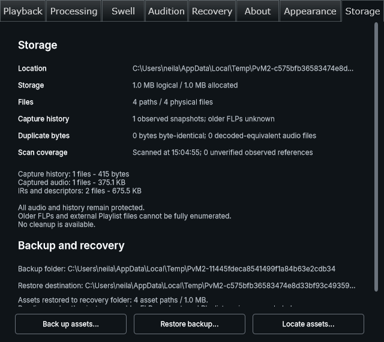

# Issue #8: Storage polish and recovery candidate — 2026-11-06

Scope: `portable-project-assets`, PR #31, issue branch `codex/8-portable-asset-design`. Tested from parent `18be50b` plus the source changes committed with this evidence. Windows 11 x64, MSVC Release, JUCE 9.0.4; existing dependency/build caches and repository build lock reused. New recovery GUI target initially compiled its own JUCE modules; no cold-build speedup claimed.

## Delivered Storage changes

- Retain the last report and timestamp when leaving, reopening or stopping a scan. Reopening performs one automatic refresh; a different session epoch/root clears the prior scope.
- Pin Backup/Restore/Locate (or Stop operation) below a focus-revealing content viewport. Actual Settings binds the panel to available height rather than scrolling the whole action bar.
- Measure category/help/status text height; remove fixed blank blocks, empty backup-folder rows and repeated success messages. Existing controls, text roles and named geometry remain in use.

## Recovery work behind the native rollout gate

Worker/control APIs preserve decodable current swell metadata through missing source, exact-closure backup validation and transactional source reload. Original legacy folder recovery copies exact aliases without creating a portable association. Re-learning is a separate provisional capture: partial/cancelled/non-finite passes do not replace accepted source; known saved source/swell spans must be complete. Saved timing/rate must match. Recovery does not Clear, replay historical generation contexts or adopt backup creative edits.

The native `preverb_portable_recovery_test --review` composition exercises real Restore/reload, explicit Re-learn confirmation/cancel, callback/worker capture and suppressed automatic generation. Required IR and missing-frozen-result consent checks precede offered generation; surviving frozen output remains retained. The current production Settings binding does **not** enable this candidate. Task 3.10 remains unchecked pending owner native review, production binding and the remaining full recovery matrix (including missing custom IR/frozen regeneration failure paths). Do not describe candidate actions as shipped or the phase as complete.

## Native verification

- Locked CMake Release rebuild of 18 affected targets, then CTest regex covering capture transaction/failure/context, workflow processor, generation configuration/Learn/automatic generation, swell engine/assets/session, processor, inventory backend/component, Storage Settings, portable backend/snapshot/panel, recovery backend/panel: **19/19 passed, 63.69 s**. `PREVERB_PORTABLE_CROSS_VOLUME_ROOT` selected the existing task-owned physical D: fixture for C:→D: tests. No unchanged-binary claim for earlier intermediate runs.
- After the last layout-only gap adjustment: rebuild four panel targets and rerun inventory panel, production Settings, portable panel and recovery panel: **4/4 passed, 4.70 s**. No further DSP/persistence changes after the 19-test run.
- Recovery tests include later creative edits, exact retained file hashes/IDs/shapes/default/auto policy, wrong source/session, cancelled copies, original-folder exact copy/cancel/wrong folder, transactional failed reload, partial/cancelled/non-finite capture and complete fresh capture. Compatible copy/reload does not render.
- `scripts/build.ps1 -Configuration Release -PluginOnly`: **PASS**, parent `18be50b` dirty-source identity; configure/build successful, CTest intentionally separate. Logs: `out/build-logs/Release/20261106-150459-8b5ca658`.
- UI standards: **PASS**, 64 files / unchanged 60 bounded occurrences. Strict OpenSpec validation and explicit semantic guide review/currency pass. No new tokens/control variants or debt-inventory regeneration.

## Fresh-profile gate remains open

`scripts/validate-portable-profile.ps1` prepares two destination-only cases (full metadata/history and zero-swell/context-only IR), then creates a temporary standard Windows account, loads its profile and checks token SID, real profile root and the plugin's default Projects path. Password stays in memory; only the task bridge receives account-specific ACL access. Cleanup checks the exact newly created SID/profile path before removal. No persistent security policy change.

Early setup attempts exposed a Windows account-description limit, credential-child working directory and inherited environment. The corrected child ran under a distinct SID and its own `C:/Users/RvRecovery…/AppData/Local/K7MA/Preverb/Projects`. It then exposed an incompatible test-fixture envelope extending beyond a three-frame frozen render; the fixture now uses compatible bounds. Every account/profile created by completed attempts was removed successfully. Prior failure logs are retained in task-owned output; they are not a passing profile result.

The final rerun was **not started: Windows elevation was cancelled**. Consequently no final fresh-profile exact-audio/metadata/zero-work acceptance is claimed; task 3.8 stays unchecked. Final local recovery-test executable SHA-256: `4E50D375578D1ED353DCA2E6AD4882B3916AC3FF162C497BD5C5CDAD1CFFD12A`. The runner must pass before completing 3.8.

## Preserved gates and coverage limits

OpenSpec remains **18/36**. No new FL Studio test/install occurred; the earlier successful same-profile host smoke remains separate. No Debug/full suite, second PC or new DPI coverage claimed. User-data remains authoritative; live folder association, independent writer ownership, durable-asset cleanup and compression remain gated. DAW/external Playlist backups remain separate. No release, merge, issue closure, canonical-spec sync or archive.
