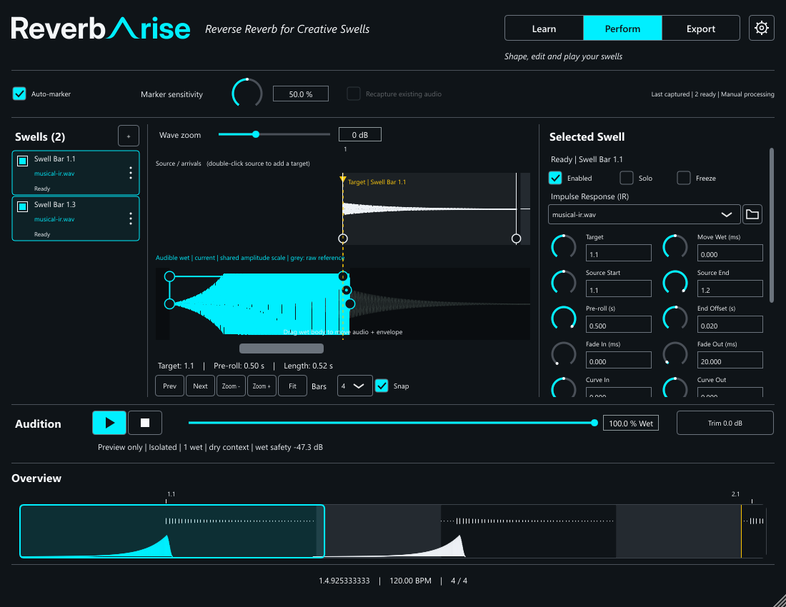

# Shared mode header — issue #16

## Stage A: presentation and library components — 2026-11-02

Change: `shared-learn-perform-export-header`. Implementation branch:
`feat/16-shared-mode-header`. This stage introduces the presentation adapter and
isolated library controls; it does not yet replace the plugin's mode dropdown.

Verified Release checks in `out/build/windows-msvc`:

| Check | Result | Scope |
| --- | --- | --- |
| `preverb_workflow_state_test` | Pass, 0.04 s | Display mapping, 720 presentation/guard comparisons across modes/phases/readiness, existing independent eligibility and state-transition assertions |
| `preverb_workflow_processor_test` | Pass, 0.33 s | Explicit durable Capture/Live/Finalise XML round-trips plus display labels, metadata-free legacy policy, unchanged version/empty parameter inventory, retained source and existing host-save/routing checks |
| `preverb_capture_transaction_test` | Pass, 0.25 s | Existing atomic capture, explicit silence replacement, retained useful source and erased-last-useful-source regressions |
| `preverb_swell_ui_test` | Pass, 6.45 s (CTest 6.50 s) | Shared components plus existing native editor, knob wheel/typing/scrolling, selection and window regression fixture |
| Strict all-spec validation | 13/13 | Existing 12 specs and the new change |
| `git diff --check` | Pass | Changed source, docs and task formatting |

The guard chain is factored once into `workflow::entryBlock`; existing admission
and the presentation adapter consume it. Durable `modeName`, XML properties,
state versions, asset identities and mode/audio semantics are unchanged. Existing
production UI still uses the temporary dropdown until the next implementation stage.

Component tests use native JUCE mouse/key events, focus traversal, asynchronous
button messages and accessibility state/actions. They verify silent refresh,
model-owned selection, active/wheel no-ops, disabled reasons, request-time model
rejection, Tab traversal, arrow inspection, Enter/Space activation, callback
lifetime and semantic icon painting independent of component name. The test-only
message-loop helper is not enabled in the plugin.

The reusable state gallery is generated at 720x540 and 560x540 via
`PREVERB_UI_M3_OUTPUT`. The UI test executable supports `--review-controls` for
an interactive fixture that creates no audio processor and needs no FL Studio.
Local review artifacts are under `out/issue16-control-checkpoint-a/`.

Owner checkpoint A initially requested an adjustment: remove rounded corners
where segment options touch. The revised selector keeps rounding only at the
outer ends, with square internal joins and a shared border. Native geometry/pixel
checks verify this; existing interactions still pass. Revised review images:
`checkpoint-a-joined-states.png` and `checkpoint-a-joined-compact.png`.
The owner explicitly approved the revised components and continuation to header
integration on 2026-11-02. This closes component checkpoint A (task 2.4), not the
integrated header checkpoint, final host acceptance or whole-library migration.

All results above are automated/native. No new FL Studio or actual Windows DPI
acceptance is claimed. The final host request remains one brief smoke test after
integration, with detailed edge cases proved by automation. The production Release
VST3 has not yet been rebuilt for delivery of this header change.

## Stage B: integrated header — 2026-11-02

The shared WorkflowHeader now replaces the temporary dropdown and owns the
wordmark, italic tagline, library selector, semantic Settings action and concise
role/status text. It uses the approved square internal joins. The old name-based
Settings glyph branch and string-returning guard adapter are removed after their
consumers migrate; one typed guard remains authoritative. Functional source
capture/live wet wording is retained. The targeted old-mode-wording audit finds
only the durable `modeName()` strings and legacy XML restore parser.

The expanded native header fixture checks ten states at three widths (1068,
1360,1560, matching editor content widths) with real native peers: empty,
dry-only, ready, recording, draining, validating, failure, incompatible timing,
frozen recovery and Export. It asserts child containment/no overlap and segment
availability/reasons. Existing editor fixtures check actual pointer/keyboard mode
requests, active-choice no-op, recording locks, selection-edit invalidation and
Settings/Diagnostics lifecycle with the new controls.

The first standalone header fixture incorrectly queried accessibility without
a native peer and hit a null handler. Giving that fixture a real peer and checking
the handler fixed it; the native UI test then passed. This was a fixture setup
failure, not a verified host crash. Native snapshot tracing remains available in
test output to identify future failing stages.

Integrated focused Release tests passed (workflow processor/state and native UI).
Full Release build and CTest subsequently passed **32/32 in 41.29 s**. Strict
all-spec validation passed **13/13**, and patch formatting checks passed. The
additional changed Debug fixtures also passed **4/4 in 7.96 s** (workflow state,
workflow processor, capture transaction and native UI, including assertions).
This is focused Debug coverage, not a full Debug-suite claim.

Delivery bundle:
`out/build/windows-msvc/preverb_plugin_artefacts/Release/VST3/ReverbArise.vst3`.
Its `Contents/x86_64-win/ReverbArise.vst3` SHA-256 is
`3a6fd0996b60a6e47d74b8dad9556392d46d45b6c30371a4b070eec438a1eb24`.
Generated module metadata retains component
`ABCDEF019182FAEB4B374D6150727631` and controller
`ABCDEF011234ABCD4B374D6150727631`. No parameter/state version/asset migration is
introduced; saved-mode compatibility assertions still pass.

Native evidence is under `out/issue16-header-checkpoint-b/`: matched Perform,
Learn and Export full-editor captures, a larger layout, header-state strips and
125/150/200% offscreen scale renders. These are geometry/native evidence, not
in-host DPI or FL Studio acceptance. **Integrated checkpoint B needs adjustment:**
the owner requested changes; detailed header feedback is pending. Task 3.5 remains
open and no final host acceptance has been requested.
The final owner host request is limited to one brief feel/mode-journey/save-reopen
smoke test after visual approval; other edge cases rely on automated regressions.

Committed native header examples at the minimum content width:

## Stage C: typography and conditional-notice refinement — 2026-11-02

The owner approved the header layout/buttons but requested larger, heavier mode
labels, an italic mode description and removal of routine source-protection text.
They then explicitly chose a conditional inline important-message bar below the
header, with temporary reflow rather than overlays. The plan/delta/tasks now
include this refinement; final integration/build checks were reopened because
the earlier full-suite and VST3 hash describe the pre-refinement build.

The native component stage uses 18-pixel bold navigation and a 13-pixel italic
description. Operational status is removed from the header. The new library
NoticeBar accepts one message/detail/severity and has information, warning and
error styles. It hides on no message, retains keyboard focus elsewhere, avoids
duplicate announcements on identical refresh and keeps detail accessible.

Focused Release verification passed: workflow-state and native-UI tests, followed
by the final native-UI fixture at **14.25 s** (CTest 14.34 s). The fixture covers
the typography/header geometry and NoticeBar visibility, severity pixels,
accessible title/detail, repeat suppression and nonmodal/focus behavior. This is
not a claim that the earlier 32/32 Release or 4/4 Debug results cover the final
message-bar integration; that binding is not implemented yet.

Review example: `out/issue16-message-bar-checkpoint/checkpoint-c-controls.png`.
The owner requested direct preview launch for future UI/component approvals;
this is recorded in AGENTS.md and the UI development standards. The native
`--review-messages` window was opened directly, without FL Studio. The owner
requested further styling adjustments; details are pending. Component checkpoint
3.6 and production notice binding 3.7 remain open. No new host acceptance is claimed.
